# [🤖 AI System Directives & Guardrails | ลำดับการอ่านที่ 2]

> **Target Audience:** สำหรับ AI Agent เท่านั้น — เอกสารฉบับนี้เป็น Single Source of Truth สำหรับกฎเหล็ก (Mandatory Rules), พารามิเตอร์บังคับ, ข้อห้าม และ Business Logic สำคัญ
> **Instruction for AI:** อ่านเอกสารนี้เป็นลำดับที่ 2 ต่อจาก `.agents/WRAPUP.md` เมื่อเริ่มต้นเซสชันใหม่ ยึดถือกฎและข้อกำหนดอย่างเคร่งครัด 100% เขียนและปฏิบัติตามแบบกระชับ ตรงประเด็น (Imperative & Concise)

---

## 📑 สารบัญ (Table of Contents)
1. [ภาพรวมระบบและปรัชญาการพัฒนา (System Overview)](#1-ภาพรวมระบบและปรัชญาการพัฒนา-system-overview)
2. [กฎและคำสั่งบังคับระดับวิกฤต (Critical Rules & Directives)](#2-กฎและคำสั่งบังคับระดับวิกฤต-critical-rules--directives)
3. [สถาปัตยกรรมระบบและการทำงานร่วมกันระหว่าง Front-end และ Back-end](#3-สถาปัตยกรรมระบบและการทำงานร่วมกันระหว่าง-front-end-และ-back-end)
4. [ตรรกะและ Business Logic สำคัญของระบบ (Core Business Logic)](#4-ตรรกะและ-business-logic-สำคัญของระบบ-core-business-logic)
5. [ข้อควรระวังและกับดักที่พบบ่อย (Critical Gotchas & Pitfalls Table)](#5-ข้อควรระวังและกับดักที่พบบ่อย-critical-gotchas--pitfalls-table)
6. [แนวทางการเขียนโค้ดและขยายโมดูล (Coding Conventions & Best Practices)](#6-แนวทางการเขียนโค้ดและขยายโมดูล-coding-conventions--best-practices)
7. [เครื่องมือและสภาพแวดล้อมที่ใช้งานอยู่ (Active Tooling & Ecosystem)](#7-เครื่องมือและสภาพแวดล้อมที่ใช้งานอยู่-active-tooling--ecosystem)

---

## 1. ภาพรวมระบบและปรัชญาการพัฒนา (System Overview)

**Pixel POS & AI Inventory** เป็นระบบบริหารงานขายหน้าร้านและจัดการสต็อกสินค้าอัจฉริยะ ออกแบบด้วยแนวคิด **"Retro Arcade Aesthetics with Modern Cloud Resilience"**:
- **ส่วนต่อประสานผู้ใช้ (UI):** สไตล์ Retro 8-bit/16-bit Arcade โทนสีคลาสสิกเรโทร พร้อมเอฟเฟกต์ CRT Scanline และเสียงสังเคราะห์ Chiptune SFX ผ่าน Web Audio API
- **สถาปัตยกรรมโค้ด (Tech Foundation):** ใช้ **Native ES6+ Modules** ล้วนโดยไม่ผ่าน Bundler ทำให้ดีบักง่าย รวดเร็ว และเป็นระเบียบ
- **ความทนทานต่อออฟไลน์ (Offline-First):** ทำงานร่วมกันระหว่างแคชในเครื่อง **IndexedDB (Dexie.js)** และฐานข้อมูลคลาวด์ **Supabase (PostgreSQL 15+)**
- **ปัญญาประดิษฐ์ (AI Integration):** ใช้ **Google Gemini Vision API** สแกนใบเสร็จ/บิลรับของเพื่อนำเข้าสต็อกอัตโนมัติ

### 📱💻 การรองรับ 2 อุปกรณ์เป้าหมายหลัก (Dual-Device Target Profiles)
ทุกการออกแบบและแก้ไข UI/UX จะต้องรองรับ 2 อุปกรณ์นี้ควบคู่กันเสมอ:
1. **Profile A — เครื่องขายหน้าร้าน (Cashier Kiosk Tablet):**
   - **อุปกรณ์:** แท็บเล็ต Android (Alldocube OS) ความละเอียด **1024 × 640 px (Landscape แนวนอน)** ต่อพ่วงปืนสแกนบาร์โค้ดบลูทูธและเครื่องพิมพ์ความร้อน
   - **ข้อบังคับ UX:** เน้นหน้า `pos.html` และ `payment.html` แบบ 2 คอลัมน์, บล็อกการเด้งของแป้นพิมพ์ระบบและ IME ของ Android ด้วย `inputmode="none"` (ใช้ปืนสแกน + เสียงพูด `🎙️` + On-Screen Numpad เป็นหลัก โดยมี Master Toggle 🔫 / ⌨️ สลับคีย์บอร์ดเฉพาะกิจเมื่อตั้งใจกดเท่านั้น)
2. **Profile B — เครื่องจัดการสต็อกและถ่ายรูปบิล (Mobile Back-Office & AI Scanner):**
   - **อุปกรณ์:** สมาร์ตโฟน Android ความละเอียด **1260 × 2800 px (Portrait แนวตั้ง 20:9 / CSS Viewport กว้าง ~360–412 px)** ใช้กล้องความละเอียดสูงถ่ายรูปสินค้าและสแกนบิลรับของ
   - **ข้อบังคับ UX:** เน้นหน้า `stockin.html` และ `products.html`, **ห้ามทำองค์ประกอบล้นขอบจอแนวนอน (< 400px)**, **ห้ามทำ Scroll ซ้อน 2 ชั้น (No Double Scrollbars)**, ใช้การ์ดแบบพับเก็บได้ (Accordion Compact Cards) เพื่อลดการเลื่อนหน้าจอแนวตั้ง, และตั้งค่า `manifest.json` เป็น `"orientation": "any"`

---

## 2. กฎและคำสั่งบังคับระดับวิกฤต (Critical Rules & Directives)

> ⚠️ **คำเตือนสำหรับ AI Agents และผู้พัฒนาทุกคน:** กฎทั้ง 19 ข้อด้านล่างนี้เป็นข้อบังคับเด็ดขาด (Mandatory Rules) ห้ามละเมิดเด็ดขาดไม่ว่าในกรณีใดๆ

---

### 📌 กฎข้อที่ 1: กฎการคืนโฟกัสช่องกรอก Barcode (Barcode Input Focus Rule)
> **Mandate:** ทุกหน้าจอที่มีการสแกนบาร์โค้ด (เช่น POS `#pos-barcode-input`, แคตตาล็อก `#prod-search-input`, หรือหน้า Stock-In) **จะต้องส่งโฟกัสกลับไปที่ช่องกรอกบาร์โค้ดทุกครั้ง** เมื่อสิ้นสุด flow การทำงานบน Pop-up / Modal / Button เช่น:
- เมื่อจบ flow การ **Re-new Barcode** (จับคู่บาร์โค้ดใหม่ให้กับสินค้าเดิม)
- เมื่อจบ flow การ **+ เพิ่มสินค้าใหม่** (Product CRUD Modal) ทั้งกรณีกดยืนยันสำเร็จ หรือกดยกเลิก/ปิด Modal
- เมื่อปิด Modal แจ้งเตือนบาร์โค้ดไม่พบ (`barcode-not-found-modal`) หรือ Modal ยืนยันใดๆ
- เมื่อสแกนและเพิ่มสินค้าลงตะกร้าในหน้าขาย (POS)
- เมื่อเสร็จสิ้นการชำระเงิน หรือเมื่อกดล้างตะกร้าสินค้า
- เมื่อกดย้อนกลับจากหน้าชำระเงิน (`views/payment.html`) กลับมายังหน้าขายหลัก (`views/pos.html`)
- **รูปแบบการคืนโฟกัสที่ถูกต้อง:** ต้องหน่วงเวลาเล็กน้อยเพื่อให้เบราว์เซอร์จัดการ Animation และเรนเดอร์ DOM เสร็จสมบูรณ์:
  ```javascript
  setTimeout(() => {
    const input = document.getElementById('pos-barcode-input') || document.getElementById('prod-search-input');
    if (input) input.focus();
  }, 100);
  ```

---

### 📌 กฎข้อที่ 2: กฎความเสถียรฐานข้อมูล Dual-Client Fallback และ Atomic Transactions (Resilient Database Rule)
> **Mandate:** ห้ามยิงคำสั่ง `supabase.from('...').update/insert/delete` ตรงๆ โดยไม่มีระบบ Fallback สำรองเด็ดขาด และการตัดสต็อก/ยกเลิกบิล/ซิงค์บิลออฟไลน์ต้องทำผ่าน Atomic Stored Procedures เมื่อเป็นไปได้
- แคชเชียร์หน้าร้านอาจทำงานภายใต้ Anonymous Session หรือ Token หมดอายุ (ทำให้เกิดข้อผิดพลาด 401 Unauthorized, 403 Forbidden หรือ RLS Restricted)
- **ข้อบังคับ:** ทุกการเขียนฐานข้อมูลต้องเรียกผ่าน Helper กลางใน `js/utils/dbHelper.js` เสมอ:
  - `resilientUpdate(supabase, table, id, payload)`
  - `resilientInsert(supabase, table, payload)`
  - `resilientDelete(supabase, table, id)`
  - `atomicAdjustStock(supabase, productId, delta, type, unitCost, note)`
  - `atomicVoidOrder(supabase, orderId, reason, timestamp)`
  - `atomicSyncOrder(supabase, orderPayload)`
- **กลไกความเสถียร 5 ชั้นใน dbHelper:**
  1. พยายามเรียก Atomic PostgreSQL RPC Function ก่อนเสมอ เพื่อรับประกันความสอดคล้องระดับธุรกรรม (ACID) และ Row-Level Locking (`FOR UPDATE`) หากฐานข้อมูลยังไม่ได้รันฟังก์ชัน RPC ระบบจะ Fallback สู่ Client-Side Logic อัตโนมัติทันทีโดยไม่โยน Unhandled Exception
  2. ยิงผ่าน Primary Supabase Client
  3. สลับไปยิงผ่าน `window.publicSupabase` (Anon Client) อัตโนมัติหากติด RLS หรือ Session หลุด
  4. ตรวจจับคอลัมน์ที่ไม่ตรงกับ Schema ของฐานข้อมูล (`PGRST204` / `extractMissingColumn`) ด้วย `while` loop แล้วตัดฟิลด์นั้นทิ้งพร้อมสั่ง Retry อัตโนมัติทันทีจนกว่าจะสำเร็จ (รองรับกรณีคอลัมน์เกินหลายตัวพร้อมกัน)
  5. ทำการบันทึกแบบไม่พ่วง `.select()` หากสิทธิ์ SELECT ของตารางถูกจำกัดภายใต้นโยบาย RLS

---

### 📌 กฎข้อที่ 3: กฎลำดับพารามิเตอร์และการเปรียบเทียบ ID (Parameter & ID Safety Rule)
> **Mandate:** การส่งอาร์กิวเมนต์และการเปรียบเทียบ Primary Key / Foreign Key ต้องเป็นไปตามมาตรฐานความปลอดภัย:
1. **ลำดับอาร์กิวเมนต์ของ `resilientUpdate`:**
   - มาตรฐานหลัก: `resilientUpdate(supabase, table, id, payload)` (ส่ง `id` ก่อน `payload` เสมอ)
   - แม้ `dbHelper.js` จะมีกลไก Polymorphic สลับลำดับให้อัตโนมัติ แต่ผู้พัฒนาต้องยึดมาตรฐานนี้เพื่อความสะอาดของโค้ด
2. **การเปรียบเทียบ ID ข้ามโมดูล:**
   - **ห้าม** ใช้ `a === b` ตรงๆ กับ ID ที่มาจาก Supabase และ IndexedDB เพราะชนิดข้อมูลอาจเป็น `String`, `Number`, หรือ `BigInt` (เช่น `'1'` กับ `1`)
   - **ข้อบังคับ:** ต้องใช้ฟังก์ชัน `safeIdCompare(a, b)` หรือแปลงด้วย `safeNumberId(id)` จาก `dbHelper.js` เสมอ

---

### 📌 กฎข้อที่ 4: กฎระบบดักจับบาร์โค้ดฮาร์ดแวร์และแก้ปัญหาผังแป้นพิมพ์ไทย (Hardware Barcode Engine & Thai Auto-Correction)
> **Mandate:** ปืนยิงบาร์โค้ดฮาร์ดแวร์ทำงานเสมือนการพิมพ์แป้นพิมพ์ความเร็วสูง (Keyboard Wedge) ระบบต้องดักจับข้อมูลอย่างแม่นยำ ป้องกันปัญหาภาษาไทยทั้งผังเกษมณีและผังปัตตโชติ (โดยเฉพาะแท็บเล็ต Alldocube OS ที่บังคับผังปัตตโชติ) ป้องกันอาการกระตุกของบลูทูธ (Bluetooth Jitter) และตัดการพิมพ์ด้วยมือของมนุษย์:
1. **In-Memory Capture ผ่าน Physical Keys (`e.code`) (เงื่อนไขที่ 1):**
   - ดักจับเหตุการณ์ที่ Capture Phase (`window.addEventListener('keydown', ..., true)`)
   - สกัดตัวเลขจาก `e.code.startsWith('Digit')` และ `e.code.startsWith('Numpad')` หรือใช้ `getCharFromPhysicalEvent(e)`
   - รองรับ Physical Key `Equal` (`e.code === 'Equal'`) หรือ `e.key === '='` แปลงเป็นตัวเลข `'1'` ทันที เพื่อแก้ปัญหาฮาร์ดแวร์สแกนเนอร์พ่นเครื่องหมาย `=` แทนเลข 1
   - เมื่อโฟกัสอยู่ที่ช่องบาร์โค้ด (`#pos-barcode-input`) ให้สั่ง `e.preventDefault()` ทันที เพื่อป้องกันไม่ให้อักขระไทยของระบบปฏิบัติการเข้าไปใน DOM แล้วนำค่าตัวเลขจาก `barcodeBuffer` ไปอัปเดตลง `.value` โดยตรง ป้องกัน DOM Repaint Lag
2. **ระบบความเร็วปรับตัวได้ (Adaptive Cadence Dual-Threshold) (คงเงื่อนไขฮาร์ดแวร์ไว้):**
   - หัวอ่านบาร์โค้ดบลูทูธไร้สายเมื่อหลับ (Standby/Sleep) แล้วตื่นขึ้นมายิง 1–3 ตัวแรก จะเกิด Latency Spike จากการ Reconnect Handshake (อาจหน่วง 80–150ms)
   - ปืนสแกนเนอร์ที่ตั้งค่าเป็น Low Transfer Rate หรือการยิงบาร์โค้ดยาว 12–14+ หลัก ต้องขยายช่วง Cadence เพื่อป้องกันการล้างบัฟเฟอร์ทิ้งกลางคัน
   - **ข้อบังคับ:** ใช้ Dual-Threshold สำหรับโหมดฮาร์ดแวร์สแกนเนอร์:
     ```javascript
     const CADENCE_FAST = 160;     // เกณฑ์ความเร็วส่งข้อมูลโหมด Low Transfer Rate & Bluetooth Jitter (120ms - 160ms)
     const CADENCE_WAKEUP = 350;   // Grace Period สำหรับ 1-3 ตัวแรกช่วงตื่น & BLE Reconnect Handshake (250ms - 350ms)
     const allowedCadence = (barcodeBuffer.length <= 3) ? CADENCE_WAKEUP : CADENCE_FAST;
     if (timeDiff > allowedCadence) barcodeBuffer = '';
     ```
   - ป้องกันอาการเลขตัวหน้านำหลุดหาย (Dropped Leading Digits) และป้องกันบัฟเฟอร์หลุดกลางคันเมื่อยิงบาร์โค้ดยาว 12–14 หลัก พร้อมตัดการพิมพ์มือของมนุษย์ (> 250ms) ทิ้งอย่างเด็ดขาด
3. **การประมวลผลเมื่อกด Enter และการรับมือสแกนผิดพลาด:**
   - เมื่อพบ `Enter` และความยาว Buffer $\ge 8$ หลัก ให้สั่ง `preventDefault()`, `stopPropagation()` (และ `stopImmediatePropagation()`) ล้างตัวแปรบัฟเฟอร์ และส่งเข้า `handleBarcodeScan(scannedCode)` ทันที
   - หากพบ `Enter` แต่ Buffer มีความยาว $< 8$ หลัก ให้ล้างบัฟเฟอร์ทิ้งทันทีเพื่อป้องกันข้อมูลไม่สมบูรณ์ตกค้างในรอบถัดไป
   - หากไม่พบสินค้า ให้เปิด `barcode-not-found-modal` ซึ่งมีป้ายตรวจจับความยาวบาร์โค้ด ($< 8$ หลัก) แจ้งเตือนกรณีสัญญาณหลุดสแกนไม่ครบ
   - ปุ่ม **`❌ สแกนผิดพลาด / ยกเลิก [N]`** ให้ระบบเข้าใจว่าเป็นการสแกนที่ผิดพลาด ล้าง buffer ในระบบ และคืนโฟกัสกลับไปที่ `#pos-barcode-input` ทันทีตามกฎข้อที่ 1
4. **การเปลี่ยนคีย์ตัวอักษรไทย ปัตตโชติ-ENG โดยอ้างอิงตรงจาก Reference 4 ชุด (เงื่อนไขที่ 2):**
   - เลิกการใช้เงื่อนไขซับซ้อน (ตัด Signature Scoring, Layout Guessing ออกทั้งหมด)
   - แปลงแบบตรงตัว 1-to-1 (`THAI_PATTACHOTE_REF_MAP`) ตามตัวอย่างจริงจากเครื่องสแกน:
     - `=` ➔ `1` (ทุกจุดที่พ่นเครื่องหมาย `=` ออกมาแทนเลข 1)
     - `ู` ➔ `6` (แถว Shift+6 ผังปัตตโชติ)
     - `๐-๙` ➔ `0-9`
     - พร้อม Fallback ปัตตโชติ unshifted (`ุ` ➔ 1, `ี` ➔ 4, `ึ` ➔ 5, `ั` ➔ 6, `่` ➔ 7, `า` ➔ 8, `ส` ➔ 9, `ว` ➔ 0) และเกษมณี
   - ทุกจุดที่รับ Input บาร์โค้ดแบบ Manual หรือ Paste รวมถึงช่องค้นหาสินค้า ต้องผ่านฟังก์ชัน:
     ```javascript
     import { normalizeThaiBarcode } from '../utils/barcodeHelper.js';
     const cleanBarcode = normalizeThaiBarcode(rawInput);
     ```

---

### 📌 กฎข้อที่ 5: กฎการคืนสถานะปุ่มก่อนแสดง Dialog (Non-Blocking UI Before Alert Rule)
> **Mandate:** คำสั่ง `alert()` หรือ `confirm()` ของเบราว์เซอร์เป็น Synchronous Blocking Call ที่จะหยุดการทำงานของ JavaScript ในหน้านั้นทันที
- **ข้อบังคับ:** ก่อนเรียก `alert(...)` หรือ `confirm(...)` แจ้งเตือนความสำเร็จหรือข้อผิดพลาด **ต้องคืนสถานะปุ่มกด (Disabled = false และเปลี่ยนข้อความปุ่มกลับเป็นปกติ) ก่อนเสมอ**
- ห้ามวางคำสั่งคืนสถานะปุ่มไว้หลัง `alert()` เพราะจะทำให้ปุ่มค้างสถานะ `กำลังบันทึก...` ในขณะที่หน้าต่างแจ้งเตือนแสดงอยู่

---

### 📌 กฎข้อที่ 6: กฎความสอดคล้องของตาราง Stock Movements (Stock Movements Schema Rule)
> **Mandate:** สกีมาของตาราง `stock_movements` ในฐานข้อมูล Supabase มีเฉพาะคอลัมน์ต่อไปนี้:
`id`, `product_id`, `type`, `quantity`, `unit_cost`, `note`, `created_at`
- **ห้าม** ส่งฟิลด์ที่ไม่มีอยู่ในตาราง เช่น `ref_invoice_no` หรือ `supplier` เข้าไปเป็นคอลัมน์เดี่ยวเด็ดขาด (จะทำให้เกิด Error PostgREST 400 ทันที)
- หากมีข้อมูลเลขอ้างอิงเอกสารหรือชื่อผู้ขาย ให้ผนวกเข้าในฟิลด์ `note` เช่น:
  ```javascript
  note: `รับเข้า ${inQty} ชิ้น จาก ${supplier} [เลขที่เอกสาร: ${invoiceNo}]`
  ```

---

### 📌 กฎข้อที่ 7: กฎการออกแบบและปรับแต่ง Layout หน้าขาย POS & Payment ยืดหยุ่นเพื่อ UX/UI (Flexible POS & Payment Layout Mandate)
> **Mandate:** โครงสร้างและ Layout ของหน้าขายหน้าร้าน (`views/pos.html`) และหน้าสรุปบิลชำระเงิน (`views/payment.html`) **อนุญาตและรองรับการปรับเปลี่ยน Layout ได้อย่างยืดหยุ่นเมื่อต้องการปรับปรุง UX/UI หรือรองรับฟีเจอร์ใหม่** (ยกเลิกข้อจำกัดห้ามเปลี่ยน Layout เด็ดขาดเดิม) เพื่อให้ตอบโจทย์การใช้งานจริงและรองรับการพัฒนาต่อยอดได้อย่างคล่องตัว:
- **หลักการปรับเปลี่ยน Layout เพื่อ UX/UI (UX/UI Adaptive Principle):**
  1. **อนุญาตปรับ Layout และขนาดเพื่อความสะดวกในการใช้งาน:** สามารถปรับเปลี่ยนโครงสร้าง, ความสูง, ขนาดปุ่มสัมผัส (เช่น เพิ่มความสูงแถบหมวดหมู่ `#pos-category-tabs-container` 80% ให้กดง่ายขึ้นบนจอสัมผัส), ระยะห่าง, การจัดวางคอลัมน์ หรือ Scrollbar เพื่อให้แคชเชียร์กดใช้งานได้สะดวกสบายยิ่งขึ้น (Touch-Friendly)
  2. **รองรับฟีเจอร์ใหม่ในอนาคต:** Layout หน้า POS และ Payment ต้องเปิดกว้างต่อการต่อยอด ปรับขนาดพื้นที่ หรือเพิ่ม Component ใหม่ๆ ได้อย่างราบรื่น ไม่ถูกล็อกโครงสร้างแบบตายตัว
  3. **คงความสะดวกและความรวดเร็วในการคิดเงิน (Fast Checkout):** ปุ่มสำคัญ เช่น ปุ่มคิดเงิน/ปิดบิล ยังคงต้องเข้าถึงและมองเห็นได้ง่าย และองค์ประกอบหลักทำงานร่วมกันได้อย่างสมดุลทั้งบนแท็บเล็ตและอุปกรณ์อื่นๆ
- **การปรับแต่งที่สอดคล้องตาม 2 อุปกรณ์เป้าหมาย (Dual-Device Alignment):**
  - **สำหรับ Profile A (Cashier Kiosk Tablet 1024×640 Landscape):** หน้า `pos.html` และ `payment.html` เน้น Zero-Scroll แนวนอน ความสูงคอนเทนเนอร์รวมไม่เกิน 540-560px เพื่อให้ทุกปุ่มคำนวณและปิดบิลอยู่ในสายตาโดยไม่ต้องเลื่อนจอ
  - **สำหรับ Profile B (Mobile Back-Office 1260×2800 Portrait):** หน้า `stockin.html` และ `products.html` **ห้ามทำองค์ประกอบล้นขอบจอแนวนอน (< 400px)**, **ห้ามทำ Double Scrollbars** โดยใช้การเลื่อนหน้าหลักชั้นเดียว (`pb-16`), ใช้ Accordion Compact Cards เพื่อลดความยาวจอ และตรึงสรุปผลด้วย Sticky Bottom Bar
- **ข้อกำหนดสำหรับหน้าจออื่นๆ ทั้งหมด (Dashboard, Orders, Products, Categories, Stock-In, Settings):**
  - **ห้ามใส่ `overflow-hidden` ที่ตัดข้อมูลทิ้งเด็ดขาด:** ทุกหน้าจอที่ไม่ใช่ POS/Payment (เช่น `views/dashboard.html`, `views/orders.html`, `views/products.html`) **จะต้องรองรับการ Scroll ระดับหน้าจอ (`overflow-y-auto` พร้อม padding ล่าง `pb-16`)** เพื่อให้ผู้ใช้สามารถเลื่อนดูข้อมูล กราฟสถิติ และการตั้งค่าต่างๆ ได้ครบถ้วนทั้งบนแท็บเล็ต แล็ปท็อป และสมาร์ตโฟน
  - **การจัดการข้อมูลที่ยาวเป็นพิเศษ (Dedicated Internal Scrollbox):** หากมีตารางหรือลิสต์ข้อมูลที่มีความยาวมาก (เช่น ตารางสินค้าในแคตตาล็อก, ตาราง Leaderboard อันดับสินค้า, ตารางแจ้งเตือนสต็อก) ให้สร้างกล่อง Scrollbox ภายใน (`max-h-[...] overflow-y-auto`) พร้อมแถวหัวตารางตรึงอยู่กับที่ (`sticky top-0 z-10`) ควบคู่กับการเลื่อนหน้าหลัก เพื่อให้อ่านข้อมูลได้อย่างเป็นระเบียบและไม่ดันองค์ประกอบอื่นจนบิดเบี้ยว

---

### 📌 กฎข้อที่ 8: กฎระบบแป้นตัวเลขรวมศูนย์ (Unified On-Screen Numpad & Zero-Replace Protection)
> **Mandate:** บนแท็บเล็ตจอสัมผัส ระบบต้องใช้แป้นตัวเลขบนหน้าจอ (On-Screen Numpad) ที่รองรับการป้อนข้อมูลอเนกประสงค์
- **การสลับเป้าหมาย (Active Target Routing):**
  - แผง Numpad ฝั่งขวาในหน้าชำระเงิน ต้องรองรับทั้งการกรอก `cash` (เงินสดที่รับมา) และ `discount` (ส่วนลดท้ายบิล) ผ่านตัวแปรสถานะ `this.activeNumpadTarget`
  - ใน Product Modal (`#prod-crud-modal`) รองรับการสลับเป้าหมาย 3 ช่อง: `stock` (สต็อก), `price` (ราคาขาย), และ `cost` (ต้นทุน)
- **การแก้ปัญหาเลข 0 ค้าง (Zero-Replace Protection):**
  - หากค่าในช่องกรอกเป็น `0`, `'0.00'` หรือเป็นค่าว่าง การกดเลข 1-9 (ไม่ว่าจะกดจาก Numpad บนจอ หรือแป้นพิมพ์ฮาร์ดแวร์) **จะต้องเข้าแทนที่เลข 0 ทันที** ป้องกันข้อผิดพลาด เช่น ต้องการลด `5` บาท แต่กลายเป็น `50` บาท หรือ `05` บาท
- **การป้อนตัวเลขทศนิยมต่ำกว่า 1 บาท (Sub-One Baht & Leading Decimal Entry):**
  - สำหรับช่องกรอกเงิน (`price`, `cost`): หากค่าเริ่มต้นเป็น `0` หรือ `0.00` การกดจุดทศนิยม `.` (หรือ `.8`) **จะต้องเปลี่ยนเป็น `0.` ทันที** และการกด `0` ตามด้วย `.` และเลขโดด (เช่น `0.8`, `0.25`) **จะต้องป้อนเลขทศนิยมได้ถูกต้องสมบูรณ์** ห้ามบล็อกปุ่มจุดทศนิยมหรือกลืนค่าทศนิยมจนกลายเป็นจำนวนเต็ม $\ge 1$ เด็ดขาด
  - ปุ่ม `C` (CLEAR) และ `Backspace` เมื่อลบจนหมดให้คืนค่าเป็น `'0'` สะอาด เพื่อให้พร้อมรับการป้อนจุดทศนิยมและตัวเลขใหม่ได้ทันที
- **การบล็อกคีย์บอร์ดเสมือนของระบบ (Soft-Keyboard Suppression):**
  - ช่องกรอกที่ต้องใช้ปืนสแกนเนอร์หรือ Numpad ของแอป (เช่น `#pos-barcode-input`, `#pos-cash-received`, `#modal-discount-input`, `#prod-input-cost`, `#prod-input-price`, `#prod-input-stock`) ต้องใส่ `inputmode="none"` เสมอ เพื่อป้องกันไม่ให้ Virtual Keyboard ของ Android เด้งขึ้นมาบดบังหน้าจอ

---

### 📌 กฎข้อที่ 9: กฎการป้องกันเบราว์เซอร์แคชและวงจรชีวิตโมดูล (Centralized Cache Invalidation & Module Lifecycle Mandate)
> **Mandate:** ระบบใช้สถาปัตยกรรม In-Memory View Cache ร่วมกับ Service Worker (Cache-First) เพื่อความเร็วสูงสุดและไม่กินพื้นที่ `localStorage` โดยมีศูนย์กลางเลขเวอร์ชัน (Single Source of Truth) อยู่ที่ `js/config.js` (`APP_VERSION`) และควบคุมหน่วยความจำด้วยวงจรชีวิตโมดูลมาตรฐาน
- **ข้อบังคับการปรับเวอร์ชัน (Cache Invalidation):** ห้ามแก้ไขเลขเวอร์ชันใน `js/config.js` หรือ `sw.js` ด้วยมือโดยเด็ดขาด ทุกครั้งที่มีการแก้ไขไฟล์ HTML, CSS, หรือ JS แม้เพียงตัวอักษรเดียว **ต้องรันคำสั่ง `npm run bump` ผ่าน Terminal ทุกครั้ง** (สคริปต์จะทำการอัปเดตทั้ง `APP_VERSION` ใน `js/config.js` และ `CACHE_NAME` ใน `sw.js` ให้ตรงกันแบบ Atomic เพื่อทำลาย Cache เก่าอย่างสมบูรณ์แบบ)
- **ข้อบังคับวงจรชีวิตโมดูล (Lifecycle & Disposables):**
  - ทุกโมดูลหน้าจอต้องมี `this.disposables = []`, เมธอด `async init()`, และเมธอด `destroy()`
  - ทุกการดักฟัง `appBus.on(...)` หรือ DOM Events ต้องเก็บฟังก์ชัน Unsubscribe ลงใน `this.disposables` เสมอ และต้องสลับหน้าผ่าน `setActiveModule()` เพื่อสั่งทำลายโมดูลเดิม ป้องกันการรั่วไหลของหน่วยความจำ (Memory Leak) บนแท็บเล็ตแคชเชียร์
- หากละเลยขั้นตอนนี้ เครื่องแท็บเล็ตของผู้ใช้จะยังคงโหลดโค้ดเก่าจากแคชเครื่อง หรือเกิดอาการหน่วง/แครชจากการสะสมของ Event Listener

---

### 📌 กฎข้อที่ 10: กฎความปลอดภัยและการจัดการข้อมูลความลับ (Strict No-Secret Exposing Rule)
> **Mandate:** ความปลอดภัยของระบบและความเป็นส่วนตัวของผู้ใช้เป็นสิ่งสำคัญสูงสุด
- **ห้าม** ใส่ข้อมูลความลับ เช่น API Keys (เช่น Gemini API Key), Database Password, Supabase Service Role Key, หรือ Token ลงในซอร์สโค้ดฝั่ง Client (`index.html`, `js/*`) หรือเอกสาร Markdown (`AGENTS.md`, `README.md`) เด็ดขาด
- การตั้งค่า Gemini API Key, Google Apps Script Web App URL หรือบัญชี PromptPay จะต้องถูกบันทึกลงในตาราง `app_settings` บน Supabase / IndexedDB ผ่านหน้าจอตั้งค่าระบบ (`views/settings.html`) พร้อมการทำ Security Masking เสมอ

---

### 📌 กฎข้อที่ 11: กฎการป้องกันการประกาศเมธอดซ้ำซ้อนและการแยกการผูก Event (Method Overwrite Prevention & Static DOM Event Guard Rule)
> **Mandate:** ใน JavaScript ES6 Classes การประกาศเมธอดชื่อซ้ำกันภายในคลาสเดียวกัน (เช่น `async init()`) จะทำให้ตัวที่อยู่ลำดับหลังเขียนทับ (Overwrite) ตัวก่อนหน้าบน Prototype โดยสมบูรณ์โดยไม่มี Error แจ้งเตือน และการผูก DOM Event ซ้ำๆ ใน SPA จะทำให้เกิด Memory Leak และฟังก์ชันทำงานเบิ้ลหลายรอบ
1. **ห้ามมีเมธอดชื่อซ้ำในคลาสเดียวกันเด็ดขาด (Strict Single Method Declaration):**
   - ก่อนบันทึกไฟล์หรือ refactor โค้ด ต้องตรวจสอบว่าไม่มีการประกาศเมธอดเดิมซ้ำสองจุด เช่น การทิ้ง `async init() { await this.loadInitialData(); }` ไว้หลังฟังก์ชัน `init()` หลัก ซึ่งจะทำให้ `bindEvents()`, `initElements()` และการทำงานเริ่มต้นทั้งหมดถูกลบล้างทิ้ง
2. **การแยกประเภท Event ระหว่าง Static DOM และ Dynamic Lifecycle (Dual-Tier Event Binding):**
   - **Static DOM Events:** ปุ่มกด, ฟอร์ม submit, input, dropzone, หัวตาราง sort ที่อยู่ใน HTML ของวิว ให้แยกไว้ในเมธอด `bindDOMEvents()` และครอบด้วยตัวแปรป้องกัน `if (this._domEventsBound) return; this._domEventsBound = true;` เพื่อให้ผูก Event เพียงครั้งเดียวตลอดอายุแอป ไม่เกิดการผูกซ้อนเมื่อผู้ใช้สลับหน้าแท็บไปมา
   - **Lifecycle Events:** การดักฟัง `appBus.on(...)` หรือ `window.addEventListener('keydown', ...)` ให้แยกไว้ใน `bindLifecycleEvents()` และต้องเก็บฟังก์ชัน Unsubscribe ลงใน `this.disposables` เสมอ เพื่อให้เมธอด `destroy()` สามารถปลดออกได้อย่างสะอาดหมดจดเมื่อสลับไปหน้าอื่น

---

### 📌 กฎข้อที่ 12: กฎระบบเสียงพูดภาษาไทยแจ้งยอดเงินและทอนเงินอัตโนมัติ (Thai Voice Announcement & Web Audio Chaining Rule)
> **Mandate:** ระบบเสียงพูดภาษาไทยต้องทำงานแบบ Non-blocking ไร้รอยต่อ (Gapless Playback) ถูกต้องตามหลักไวยากรณ์ภาษาไทย และไม่กระทบการทำงานหลักของแคชเชียร์:
1. **การทำงานร่วมกับเสียง SFX เดิม (Co-existence):**
   - เมื่อชำระเงินสำเร็จ ให้เล่นเสียงสังเคราะห์ 8-bit `stage_clear` สั้นๆ ก่อน แล้วหน่วงเวลา ~0.2 วินาที (200ms) จึงเริ่มเล่นเสียงพูดภาษาไทย เพื่อคงเสน่ห์เกมเรโทรควบคู่กับความสะดวกในการฟัง
2. **การแปลงตัวเลขและไวยากรณ์ภาษาไทย (`numberToThaiAudioList`):**
   - **คำว่า "เอ็ด" (`num_11.wav`):** ต้องใช้เมื่อเลข 1 อยู่ในหลักหน่วยและมีหลักที่มากกว่าสิบอยู่ข้างหน้า (เช่น 11, 21, 31, 101, 1001, 20001) แต่หากเป็นเลข 1 เดี่ยวๆ ให้ใช้ "หนึ่ง" (`num_1.wav`)
   - **คำว่า "ยี่สิบ" (`num_20.wav`) และ "สิบ" (`num_10.wav`):** ต้องแปลงตัวเลข 20 เป็น `num_20.wav` และ 10 เป็น `num_10.wav` โดยไม่นำ `num_1` หรือ `num_2` มาต่อหน้าคำว่าสิบ
   - **หลักแสน (`unit_100000.wav`) และหลักหมื่น (`unit_10000.wav`):** ต้องรองรับตัวเลขหลักแสน ($\ge 100,000$) ต่อท้ายด้วย `unit_100000.wav` และกระจายเศษส่งต่อหลักหมื่นและพันตามหลักภาษาไทยอย่างเป็นธรรมชาติ
   - **เศษสตางค์ (`unit_satang.wav`):** หากยอดเงินมีเศษทศนิยมมากกว่า 0 (เช่น 25.50 บาท) ให้อ่านส่วนสตางค์ตามจริงต่อท้ายส่วนบาทเสมอ เช่น `[25] + unit_baht.wav + [50] + unit_satang.wav`
3. **โครงสร้างคิวประโยคตามประเภทการชำระเงิน (`speakCheckout`):**
   - **เงินสดพอดี (Exact Cash):** `['prefix_all.wav', ...totalList, 'unit_baht.wav', ...satangIfAny, 'pay_cash_exact.wav', 'thank_you.wav']`
   - **QR Code / พร้อมเพย์ / โอนเงิน:** `['prefix_all.wav', ...totalList, 'unit_baht.wav', ...satangIfAny, 'pay_qr.wav', 'thank_you.wav']`
   - **เงินสดมีเงินทอน (Cash with Change):** `['prefix_all.wav', ...totalList, 'unit_baht.wav', ...satangIfAny, 'pay_cash.wav', ...cashList, 'unit_baht.wav', 'change.wav', ...changeList, 'unit_baht.wav', ...changeSatangIfAny, 'thank_you.wav']`
   - **ร่วมจ่าย (Split: โอน/QR + เงินสด):** `['prefix_all.wav', ...totalListWithUnit, 'pay_qr.wav', ...transferListWithUnit, 'pay_cash.wav', ...cashListWithUnit, ...changeListWithUnitIfAny, 'thank_you.wav']` (ตัวอย่าง: *"ทั้งหมด 88 บาท รับเงินทาง คิวอาร์โค้ด 80 บาท รับเงินสด 8 บาท ขอบคุณค่ะ"*)
4. **ความต่อเนื่องของเสียงและการหยุดคิว (Gapless Web Audio Engine & Cancellation):**
   - ต้อง Preload และแคชไฟล์เสียงทั้ง 25 ไฟล์ลงใน `Map<string, AudioBuffer>` พร้อมพารามิเตอร์ `?v=${APP_VERSION}` เพื่อหลีกเลี่ยงความหน่วงของเครือข่ายและแคชค้าง
   - เชื่อมต่อเสียงด้วย `AudioContext.currentTime` แบบ Micro-crossfade ต่อเนื่องไร้รอยต่อ ป้องกันเสียงขาดช่วง (Audio Jitter)
   - หากมีการเปิดบิลใหม่ หรือมีเสียงพูดใหม่แทรกเข้ามา ต้องเรียก `stopVoice()` หยุดคิวเดิมทันที
   - เคารพสถานะ Mute จาก `isAudioMuted()` และการเปิด/ปิดเสียงพูดจาก `isVoiceEnabled()` (`pixel_pos_voice_enabled`)
5. **มาตรฐานการสังเคราะห์และตัดเสียง 25 ไฟล์ (SSML Batch 1.5s & Pristine Trimming Standard):**
   - ใช้เสียง **Voice: Aoede** โทนผู้หญิงสดใส สุภาพ น่าเชื่อถือ
   - สังเคราะห์ทั้ง 25 คำใน Take เดียว (Single Batch Request) โดยใช้แท็ก SSML ` <break time="1.5s"/> ` คั่นระหว่างคำ เพื่อรักษาความคงที่ของระดับเสียง (Pitch), ความดัง (Volume), และจังหวะพูด (Cadence) ให้เป็นเนื้อเดียวกัน 100%
   - ระวังการออกเสียงเลข 9 (`num_9.wav` ต้องมีพยัญชนะ ก ชัดเจน ไม่กลืนเป็น "อ้าว") และ 10,000 (`unit_10000.wav` ต้องเป็นวรรณยุกต์เอก ชัดเจน ไม่ใช่ "หมืน")
   - ต้องตัดช่วงเงียบ (Silence Trimming) พร้อมใส่ Linear Fade-In 6ms และ Fade-Out 6ms ดึงแอมพลิจูดลงสู่ 0 เพื่อป้องกันเสียงคลิกและตัดก้อนขยะ Binary Metadata (C2PA) ท้ายไฟล์ออก 100% ป้องกันเสียงซ่าท้ายคำทุกไฟล์

---

---

### 📌 กฎข้อที่ 13: กฎระบบสั่งเพิ่มสินค้าด้วยเสียงพูดภาษาไทย (Thai Voice-to-Cart Engine & PWA Permission Rule)
> **Mandate:** ระบบสั่งเพิ่มสินค้าลงตะกร้าด้วยเสียงพูดภาษาไทย (Web Speech API) ต้องมีความทนทาน ทำงานร่วมกับสภาพแวดล้อม PWA/HTTPS อย่างถูกต้อง มีสัญญาณเสียงไกด์ สัญญาณภาพที่ชัดเจน และมีตรรกะการจับคู่สินค้าที่ชาญฉลาด:
1. **การขอสิทธิ์ไมโครโฟนบน PWA / Secure Context:**
   - Web Speech API บน Android/Chromium ต้องทำงานบน Secure Context (`https://` หรือ `http://localhost`) เสมอ
   - ก่อนเรียก `recognition.start()` ต้องเรียก `ensureMicPermission()` ผ่าน `navigator.mediaDevices.getUserMedia({ audio: true })` เพื่อกระตุ้นให้ Android แสดง System Dialog ขออนุญาตไมโครโฟน และคืนทรัพยากรทันทีพร้อมหน่วงเวลา ~80ms ให้ฮาร์ดแวร์เสียงของแท็บเล็ตพร้อมใช้งาน ป้องกัน `audio-capture error`
2. **สัญญาณเสียงไกด์ "ติ๊ด!" (Acoustic Cue Beep):**
   - เมื่อไมโครโฟนเริ่มรับเสียงจริง (`recognition.onstart`) ให้ส่งเสียงสังเคราะห์ 8-bit `playVoiceGuideBeep()` (1046.5Hz ➔ 1174.6Hz) ทันที เพื่อให้แคชเชียร์ทราบจังหวะเริ่มพูดอย่างแม่นยำ
3. **ระบบการแสดงผลสองระดับ (Two-Tier Visualizer & Sound Wave Animation):**
   - ปุ่มไมค์ 2 แถวด้านซ้าย (`.pixel-btn-mic-tall`) ต้องเปลี่ยนเป็นสีแดงสดเรโทรพร้อมประกาย CRT Glow (`retro-mic-pulse`), แสดงแถบคลื่นเสียง Equalizer 4 แท่ง (`.voice-sound-waves`), และข้อความ `● กำลังฟัง`
   - แบนเนอร์ด้านบนแคตตาล็อกสินค้า (`#pos-voice-banner`) ต้องแสดงสถานะพร้อมไฟกะพริบ (`animate-ping`) และสตรีมข้อความสด (Interim Transcript) ขณะกำลังพูดแบบเรียลไทม์ พร้อมปุ่ม `✕ ยกเลิก` (และรองรับการกดยกเลิกผ่านปุ่ม `Esc` หรือ `F3`)
4. **ตรรกะการวิเคราะห์คำสั่งเสียงและราคาสินค้า (`parseThaiVoiceCommand`):**
   - หากพูดชื่อสินค้าอย่างเดียว หรือพูดชื่อสินค้าพร้อมราคา (เช่น *"โค้ก 20 บาท"*) ให้ถือว่าจำนวนสินค้าคือ **1 หน่วย** เสมอ
   - แยกแยะคำระบุราคา (เช่น *"20 บาท"*, *"ยี่สิบบาท"*) ออกจากจำนวน และใช้ราคานี้เป็นตัวจับคู่สินค้าที่มีระดับราคาใกล้เคียงที่สุด (เช่น *"โค้ก 20 บาท"* จับคู่กับ *"โค้ก 590 มล."* ราคา 19 บาท)
   - สกัดคำเรียกหน่วย/บรรจุภัณฑ์ (เช่น *ขวด, กระป๋อง, กลม, แบน, ซอง, คัพ, ถ้วย, แก้ว, กล่อง, แพ็ค, ลัง, ชิ้น*) ทั้งที่มีจำนวนตัวเลขนำหน้า (เช่น *"ลีโอ 1 ขวด"*, *"หงส์ 1 กลม"*) หรือไม่มีตัวเลข (เช่น *"ลีโอขวด"*, *"หงส์กลม"*, *"หงส์แบน"*, *"มาม่าคัพ"*)
5. **การคืนโฟกัสตามกฎข้อที่ 1:**
   - เมื่อเสร็จสิ้นกระบวนการสั่งด้วยเสียง (ทั้งกรณีสำเร็จ, ยกเลิก หรือ Error) จะต้องส่งโฟกัสกลับไปที่ `#pos-barcode-input` ด้วย `this.focusBarcodeInput(100)` เสมอ
6. **ระบบค้นหาตัวเลือกแบบ Variations และสถาปัตยกรรม 3 ลำดับความสำคัญ (Strict 3-Tier Priority Matching & $\le 10$ Variation Cards):**
   - **สถาปัตยกรรม 3 ลำดับความสำคัญในการคัดเลือกสินค้า (Strict 3-Tier Multi-Level Priority):**
     - **Priority 1 (ชื่อสินค้า / แบรนด์):** จับคู่ชื่อสินค้าหลัก คีย์เวิร์ด และคำประสม (`extractVoiceRelatedKeywords`) เช่น *"โค้ก"*, *"ลีโอ"*, *"หงส์"*, *"มาม่า"*, *"เนสกาแฟ"*, *"เลย์ร๊อก"* โดยกลุ่ม High Relevance ($\ge 80$) จะต้องชนะคำจับคู่ที่ไม่เกี่ยวข้องเสมอ
     - **Priority 2 (คำเรียกหน่วย / บรรจุภัณฑ์):** หากลูกค้าระบุหน่วย (`checkProductUnitMatch`) สินค้าที่มีบรรจุภัณฑ์ตรงกัน (`+1`) หรือเป็นกลาง (`0`) **จะต้องชนะสินค้าที่มีบรรจุภัณฑ์ขัดแย้ง (`-1`) เสมอ** โดยไม่ให้ราคามาหักล้าง เช่น เมื่อพูด *"โค้ก 15 บาท 1 ขวด"* ระบบจะเลือกขวด (เช่น โค้ก 450มล. 17 บาท) ไม่เลือกกระป๋องเด็ดขาดแม้กระป๋องจะราคา 15 บาทตรง รวมถึงรองรับคำเพี้ยน/สแลง (`THAI_UNIT_ALIASES` เช่น *"ชวด"* ➔ *"ขวด"*, *"ป๋อง"* ➔ *"กระป๋อง"*, *"ห่อ"* ➔ *"ซอง"*, *"ถ้วย"* ➔ *"คัพ"*)
     - **Priority 3 (ระดับราคา):** เมื่อสินค้าอยู่ในกลุ่มชื่อเดียวกันและหน่วยนับเดียวกัน (เช่น โค้กขวด: 13บ., 17บ., 19บ., 32บ.) จะนำ `targetPrice` มาตัดสินหาสินค้าที่มีราคาตรงในชื่อ หรือมีผลต่างราคาต่ำที่สุด เช่น *"โค้ก 19 บาท 1 ขวด"* (หรือ *"โค้ก 19 บาท 1 ชวด"*) จะได้ *"โค้ก 590 มล."* (19฿) หรือ *"เนสกาแฟ 17 บาท"* จะได้ *"เนสกาแฟ 17 บาท 1 กระป๋อง"* ทันที
     - **Tie-Breaker:** หากผ่านทั้ง 3 ระดับแล้วเสมอกัน ให้ตัดสินด้วยสถิติยอดขายจริง (`salesStatsGetter`) และลำดับสินค้าในแคตตาล็อก
   - เพื่อป้องกันความผิดพลาดและอำนวยความสะดวกสูงสุด ระบบจะวิเคราะห์คำใกล้เคียง คีย์เวิร์ดแบรนด์/ตระกูลสินค้า (`getProductBrandKeywords`), แยกคำประสม (`extractVoiceRelatedKeywords`), รองรับเสียงใกล้เคียง (Sound-Alikes เช่น "ร๊อก" <-> "ร็อค", "หงส์" <-> "หงษ์"), และส่วนขยาย Prefix
   - นำสินค้าตัวเลือกใกล้เคียง/Variations มาแสดงบน Grid หน้าร้าน (`pos-card-content`) รวมสูงสุด **10 การ์ด**
   - การ์ดที่ถูกเพิ่มลงตะกร้าแล้ว (Top Match) จะถูกเน้นด้วยกรอบสีเขียว Emerald และเอฟเฟกต์ไฟ Pulse (`.voice-card-auto-added`) พร้อมป้าย `✓ เพิ่มแล้ว`
   - การ์ดตัวเลือก Variations อื่นๆ จะมีป้าย `+ เลือกตัวนี้` เพื่อให้แคชเชียร์แตะสลับหรือสั่งตัวเลือกอื่นได้ทันทีเพียงคลิกเดียว และคืนโฟกัสกลับไปที่ `#pos-barcode-input` เสมอตามกฎข้อที่ 1
7. **กฎการยกเลิกไม้ยมก "ๆ" และขยายคำซ้ำอัตโนมัติ (Maiyamok "ๆ" Abolition & Reduplication Expansion Mandate):**
   - ฐานข้อมูลสินค้าภาษาไทยจะไม่ใช้ไม้ยมก "ๆ" ในชื่อสินค้าเด็ดขาด (เช่น "เย็นเย็น", "เบงเบง", "ไวไว", "ยำยำ", "ชาช่า") ดังนั้น เมื่อผู้ใช้สั่งด้วยเสียงหรือ Web Speech API แปลงเสียงเป็นตัวอักษร ระบบต้องไม่ใช้คำค้นที่มี "ๆ" เช่น "เย็นๆ" หรือ "เบงๆ" เด็ดขาด
   - ทุก Input เสียงต้องผ่าน `normalizeThaiMaiyamok()` เพื่อขยายคำซ้ำเต็มคำ (เช่น *"เย็นๆ"* ➔ *"เย็นเย็น"*, *"เบงๆ"* ➔ *"เบงเบง"*, *"ไวๆ"* ➔ *"ไวไว"*, *"โออิชิเย็นๆ"* ➔ *"โออิชิเย็นเย็น"*) และตัดไม้ยมก `ๆ` ออกทั้งหมด ให้เลิกใช้ไม้ยมก "ๆ" ในการค้นหาไปโดยสิ้นเชิง
8. **กฎระบบค้นหาแบบไม่ยึดติดรูปวรรณยุกต์และความใกล้เคียงของคำ (Thai Tone-Agnostic & Approximate Phonetic Matching Mandate):**
   - การออกเสียงวรรณยุกต์และแบบจำลองรู้จำเสียงพูด (Web Speech API) ในภาษาไทยมักถอดเสียงออกมามีหรือไม่มีรูปวรรณยุกต์ หรือใช้วรรณยุกต์คนละรูปกับชื่อสินค้าในฐานข้อมูล เช่น ผู้พูดพูดว่า *"มิ้ลค์"* แต่ระบบแปลงเป็น *"มิลค์"*, หรือ *"โค้ก"* ➔ *"โค๊ก"*, *"เป๊ปซี่"* ➔ *"เปปซี่"*, *"สไปร์ท"* ➔ *"สไปรท์"*
   - **ข้อบังคับ:** ระบบค้นหาด้วยเสียง (`findVoiceCandidatesAndTopMatch`), การจับคู่อัจฉริยะ (`matchProductIntelligently`), และช่องพิมพ์ค้นหาหน้าร้าน (`getFilteredAndSortedProducts`) จะต้องรองรับ **Tone-Agnostic / Tone-Insensitive Matching**:
     - สกัดรูปวรรณยุกต์ด้วย `stripThaiToneMarks(str)` (ตัด `\u0E48-\u0E4B` ได้แก่ ่, ้, ๊, ๋)
     - สกัดวรรณยุกต์และเครื่องหมายกำกับเสียงด้วย `stripThaiTonesAndDiacritics(str)` (ตัด `\u0E47-\u0E4E` ได้แก่ ็, ์, ่, ้, ๊, ๋)
     - คำสั่งเสียงเช่น *"ไวตามิลค์ทูโก"* หรือ *"ไวตามิลค์"* จะต้องจับคู่สินค้าแคตตาล็อก *"ไวตามิ้ลค์ทูโกน้ำนมถั่วเหลืองยูเอชทีสูตรออริจินัล 300 มล."* ได้อย่างแม่นยำในระดับ **High Relevance Tier ($\ge 80$)**
     - หากตรวจไม่พบคู่เทียบตรงตัว ระบบจะมีระบบสำรองคำนวณความใกล้เคียงของคำ `calculateThaiSimilarity(str1, str2)` ผ่าน Bigram Dice Coefficient ($\ge 0.70$) เพื่อรองรับกรณีคำเพี้ยนจากการรับเสียงของ STT

---

### 📌 กฎข้อที่ 14: กฎการจัดการสต็อกสินค้าปิดการขาย และตัวกรองคลังสินค้า (Inactive Inventory Auto-Zero & Filter Rules)
> **Mandate:** การจัดการสถานะสินค้า สต็อกคงเหลือ และตัวกรองในหน้า Inventory ต้องเป็นไปตามมาตรฐานความถูกต้องทางบัญชีและความคล่องตัวในการปฏิบัติงานหน้าร้าน:
1. **การรีเซ็ตสต็อกเป็น 0 อัตโนมัติเมื่อ "ปิดการขาย" (Auto Re-stock to 0):**
   - เมื่อสินค้าถูกเปลี่ยนสถานะเป็น "ปิดการขาย" (`is_active === false`) ระบบจะบังคับรีเซ็ตจำนวนสต็อกคงเหลือเป็น `0` ชิ้นทันทีทั้งในหน้าฟอร์มและในฐานข้อมูล Supabase / IndexedDB (`stock = 0`) เพื่อป้องกันการคำนวณมูลค่าทุนตกค้างและป้องกันการขายผิดพลาด
   - ฟังก์ชันคำนวณมูลค่าทุนรวม (`updateStats()`) ในหน้าจัดการสินค้า จะคำนวณเฉพาะสินค้าที่เปิดการขาย (`is_active !== false`) เท่านั้น
   - **ข้อควรระวังสำคัญ:** ห้ามแตะต้องหรือแทนที่ `.innerText` ของการ์ดคอนเทนเนอร์ `#card-modal-num-stock` เด็ดขาด เพราะจะทำให้โครงสร้าง DOM ภายใน (ป้ายชื่อและ `<input id="prod-input-stock">`) สูญหาย การอัปเดตตัวเลขต้องกระทำผ่าน `input.value` เท่านั้น
2. **การจัดระเบียบตัวกรอง 11 หมวดหมู่ (Default Active & Filter Sequence):**
   - หน้า Inventory ต้องเริ่มต้นที่ตัวกรอง **"เปิดขาย" (`data-filter="ACTIVE"`)** เสมอ (แทนค่าเดิม "ทั้งหมด") เพื่อให้แคชเชียร์เห็นเฉพาะสินค้าที่พร้อมจัดการขายหน้าร้านทันที
   - ลำดับปุ่มตัวกรองทั้ง 11 ปุ่มต้องเรียงตามมาตรฐาน:
     `เปิดขาย` | `พร้อมขาย` | `ใกล้หมด` | `หมดสต็อก` | `🚨 ติดลบ` | `♾️ ไม่นับสต็อก` | `🆕 สินค้าเพิ่มใหม่` | `🔄 เปลี่ยนแปลงล่าสุด` | `⚡ ขายด่วน` | `ปิดขาย` | `ทั้งหมด`
3. **การเปลี่ยนบาร์โค้ดแบบ Touch-Friendly & การถ่ายรูปสินค้าด่วน (Quick Photo):**
   - รวมพื้นที่ตัวเลขบาร์โค้ดและไอคอน `🔄` ในตารางสินค้าให้สามารถคลิกได้ทั้งก้อน เพื่อเปิด Modal Re-new Barcode ได้อย่างสะดวกบนจอสัมผัส และย้ายปุ่มคัดลอกไปไว้ใน Modal
   - รองรับการแตะที่รูปภาพสินค้าในตารางเพื่อเปิด Modal ถ่ายรูปด่วน (Quick Photo) พร้อมบันทึกลงฐานข้อมูลและ Google Drive ทันที และคืนโฟกัสกลับไปที่ `#prod-barcode-input` เสมอตามกฎข้อที่ 1

---

### 📌 กฎข้อที่ 15: กฎมาตรฐานไอค่อนและการจัดเก็บไฟล์ที่ไม่ได้ใช้ (Unified Icon Standard & Unused Files Archiving Rule)
> **Mandate:** ระบบใช้มาตรฐานไอค่อนผสมผสานอย่างลงตัวระหว่าง Font Awesome 6 Free (Offline-Ready) และ Custom Pixel Art Assets เพื่อความชัดเจน กึ่งกลางสมดุล (Center / Justify) และคงอัตลักษณ์เกมเรโทร:
1. **การใช้งาน Font Awesome 6 Free แบบ Offline 100%:**
   - ติดตั้งไฟล์ CSS และ Web Fonts (`fa-solid-900.woff2`) ใน `assets/fontawesome/` และแคชใน `sw.js` ป้องกันปัญหาโหลดไม่ได้เมื่อออฟไลน์
   - ไอคอนมาตรฐานใช้คลาส `fa-solid fa-...` พร้อมคลาสจัดกึ่งกลางและการจัดแนวให้สมดุล เช่น `fa-arrows-rotate` สำหรับ Re-new Barcode, `fa-fire text-amber-500` สำหรับหมวดขายด่วน, `fa-chevron-left` สำหรับปุ่มย้อนกลับ [Esc], `fa-money-bill-transfer` สำหรับรวมจ่าย, `fa-percent` สำหรับส่วนลด, `fa-delete-left` สำหรับล้างเงินสด, และ `fa-pen-to-square` / `fa-trash-can` สำหรับปุ่มจัดการในตาราง
2. **กราฟิก Pixel Art พิเศษประจำแอป (Custom Pixel Identity):**
   - โลโก้แอปพลิเคชัน (`#pixel-icon-calc` จาก `assets/icons/pixel-calc.svg`) เป็นเครื่องคิดเลข 2.5D Pixel Isometric แทนรูป Joystick เดิมทั้งบนแถบเมนูด้านบน, Boot Loader และ Login Modal
   - เหรียญทองพิกเซล (`#pixel-icon-coin` จาก `assets/icons/pixel-coin.svg`) แทนรูปเหรียญเงินสดในปุ่มลัดรับเงินสดและแท็บชำระเงินสด
3. **การจัดการไฟล์ที่ไม่ได้ใช้งานแล้ว (Unused Files Archiving Rule):**
   - ไฟล์ที่ไม่จำเป็นต่อการพัฒนา (เช่น showcase ชั่วคราว, สคริปต์ generate แบบ one-off, ไฟล์ไอคอนซ้ำซ้อนใน root) ต้องถูกย้ายไปไว้ในโฟลเดอร์ `/unused_files`
   - โฟลเดอร์ `unused_files/` ต้องถูกระบุใน `.gitignore` เสมอ ห้าม push ขึ้น Git เด็ดขาด
   - ต้องมีไฟล์ `unused_files/CATALOG.txt` บันทึกรายการ ที่มา หน้าที่เดิม และเหตุผลในการย้าย เพื่อประโยชน์ในการ clean up โปรเจกต์ในอนาคต

---

### 📌 กฎข้อที่ 16: กฎการแสดงผลและปรับปรุงขั้นตอนตรวจรับสต็อกและการคิดเงิน (Stock-In Staging & Payment Mode Ergonomics Rule)
> **Mandate:** ขั้นตอนการตรวจรับสต็อกสินค้าด้วย AI (Gemini Vision) และหน้าต่างคิดเงิน (Payment) ต้องคำนึงถึงความชัดเจน ป้องกันความสับสนของแคชเชียร์ และรองรับรูปแบบเอกสารจริง:
1. **การหมุนภาพใบเสร็จด้วย Offscreen Canvas (Physical Pixel Rotation):**
   - การหมุนภาพถ่ายใบเสร็จ (`หมุนซ้าย 90°` / `หมุนขวา 90°`) ต้องกระทำผ่าน HTML5 Canvas ในระดับพิกเซลจริงเพื่ออัปเดต `this.currentBase64` ก่อนส่งให้ Google Gemini Vision OCR (ห้ามหมุนเฉพาะ CSS `transform` เด็ดขาด เพราะ Gemini Vision จะยังคงอ่านภาพในทิศทางเดิมทำให้เกิดข้อผิดพลาด OCR)
   - มีปุ่มสลับมุมมอง `ขยายเต็มจอ / พอดีกรอบ` และป้ายทิศทางภาพอัตโนมัติ (`#stockin-orientation-badge`)
2. **Workflow บาร์โค้ดสินค้าใหม่ใน Modal ค้นหา/จับคู่สินค้า:**
   - เมื่อสแกนบาร์โค้ดใน Modal ค้นหาสินค้าเดิม (`#modal-stockin-product-picker`) แล้วไม่พบสินค้าในระบบ จะต้องแสดงปุ่ม **`➕ นำบาร์โค้ดนี้ไปใช้เป็นสินค้าใหม่`** (`#btn-picker-use-barcode-new`) เพื่อส่งบาร์โค้ดกลับไปกรอกลงในการ์ดรับสินค้าทันที และคืนโฟกัสตามกฎข้อที่ 1
3. **มาตรฐานคำเรียกหน่วยสินค้าในหน้า Stock-In (Standard Stock-In Units):**
   - ใช้คำว่า `"กล่อง"` (แทน ลัง), `"จำนวนหน่วยในกล่อง"` (แทน ชิ้นใน 1 แพ็ค), `"กล่องละ"` (แทน ราคาซื้อ/แพ็ค), `"ทุน/หน่วย"` / `"ราคาขาย/หน่วย"` (แทน ทุน/ชิ้น, ราคา/ชิ้น) และ `"หน่วย"` (แทน ชิ้น)
   - ลำดับช่องแถวที่ 4 ในการ์ดรับสินค้า: `จำนวนกล่อง` ➔ `กล่องละ (฿)` ➔ `จำนวนหน่วยในกล่อง` ➔ `ทุน/หน่วย (฿)` ➔ `ราคาขาย/หน่วย (฿)` และย้าย `"รวมรับเข้า"` ไปไว้ขวาสุดของแถวที่ 5
4. **ระบบกรอบสีเน้นประเภทการรับเงินเพื่อป้องกันการสับสน (Payment Option Mode Attention Engine):**
   - Section ฝั่งขวาในหน้าชำระเงิน (`#pos-checkout-col-right`) ต้องเปลี่ยนสีกรอบอย่างชัดเจนตามประเภทการรับเงิน พร้อมเอฟเฟกต์ Outer Glow:
     - **เงินสด (CASH):** กรอบสีส้มสดใสเรโทร (`border: 3.5px solid #f97316`)
     - **โอนเงิน / QR (PROMPTPAY):** กรอบสีม่วงเด่นชัด (`border: 3.5px solid #9333ea`)
     - **ร่วมจ่าย (SPLIT: สด+โอน):** กรอบสีชมพูสะดุดตา (`border: 3.5px solid #ec4899`)
   - ปุ่มแท็บทั้ง 3 ต้องเปลี่ยนพื้นหลังเป็นสีประจำหมวดหมู่นั้นเมื่อ Active
5. **การ์ดตรวจรับสินค้าแบบสูตรคณิตศาสตร์ต่อเนื่อง (Mathematical Formula Chunking) และการสลับสี Zebra Striping:**
   - การ์ดตรวจรับสินค้า (`.stockin-card`) และแถวตาราง (`stockin-table tr`) ใช้ระบบ **Alternating Zebra Striping** สลับสีพื้นหลังระหว่างการ์ดคู่ `bg-white` และการ์ดคี่ `bg-[#FAF7F0]` (สีนวลกระดาษเรโทร) เพื่อช่วยให้สายตาแคชเชียร์แยกแยะสินค้าแต่ละรายการได้ทันที ไม่ตาลายเมื่อมีสินค้าหลายรายการ
   - **โครงสร้างการ์ดตรวจรับสินค้า (Card Ergonomics):**
     - **ส่วนบน:** ป้าย `#ลำดับ` สีเหลืองเด่นชัด (`bg-amber-400`), ป้ายสถานะ (`✨ สินค้าใหม่` / `🔗 เดิม:`), ช่องบาร์โค้ดพร้อมไอคอน `🏷️`, กล่องรูปสินค้าสี่เหลี่ยมขอบประพร้อมปุ่มกล้อง `📷` ถ่ายรูปด่วน, และปุ่มลบ `✕` สีแดงมุมขวาบน
     - **ส่วนกลาง:** ช่องชื่อสินค้ากว้างเต็มตา และปุ่มลัด `📁 หมวดหมู่ | 📦 หน่วย`, `🔗 จับคู่สินค้าเดิม`, `🧮 คำนวณ`
     - **กลุ่มสูตรคณิตศาสตร์ (Grouped Math Equations):**
       - บรรทัด 1: `กล่อง×หน่วย` $\rightarrow$ `[-] [จำนวนกล่อง] [+]` $\times$ `[-] [หน่วย/กล่อง] [+]` $=$ `[รวมชิ้น]`
       - บรรทัด 2: `ราคา/หน่วย` $\rightarrow$ `[กล่องละ ฿]` $/$ `[หน่วย/กล่อง]` $=$ `[ทุน/หน่วย ฿]` (กดปุ่มเปิดเครื่องคำนวณได้)
       - บรรทัด 3: `ราคาขาย(กำไร)` $\rightarrow$ ตัวเลขราคาขายขนาดใหญ่ `[ราคาขาย] ฿` พร้อมป้ายกำไร `[+กำไร (Margin%)]`
     - **แถบล่าง (Footer Bar):** `รวมรับเข้า: [รวมชิ้น] หน่วย | คงเหลือใหม่: [สต็อกใหม่] หน่วย`
   - **การจัดเรียงตารางรับสินค้า (Table View Re-ordering):** จัดเรียงคอลัมน์ตามลำดับการคำนวณจากซ้ายไปขวา: `#` $\rightarrow$ `รูป` $\rightarrow$ `ชื่อสินค้า/บาร์โค้ด` $\rightarrow$ `📦 จำนวนกล่อง` $\rightarrow$ `✖ หน่วย/กล่อง` $\rightarrow$ `= รวมรับเข้า` $\rightarrow$ `💰 กล่องละ (฿)` $\rightarrow$ `= ทุน/หน่วย (฿)` $\rightarrow$ `🏷️ ราคาขาย (กำไร)` $\rightarrow$ `ลบ`
   - ในโมดัลจับคู่สินค้า (`#modal-stockin-product-picker`) ชู 2 ระบบหลัก: **🎙️ ค้นหาด้วยเสียง [Voice Search]** (Web Speech API ภาษาไทย พร้อมแบนเนอร์ฟังเสียงสด) และ **📷/⚡ สแกนบาร์โค้ด (กล้องและปืนยิง)** พร้อมรักษาคำค้นหาภาษาไทย ไม่นำคำค้นหาไปแปลงผ่าน `normalizeThaiBarcode` จนสระ/พยัญชนะไทยเพี้ยน

---

### 📌 กฎข้อที่ 17: กฎระบบจับคู่และค้นหาสินค้าอัจฉริยะแบบสองภาษาและการป้องกันความขัดแย้งของสีและแบรนด์ (Intelligent Bilingual Product Matcher, Space-Agnostic & Brand-Color Conflict Protection Rule)
> **Mandate:** ตรรกะการจับคู่สินค้าส่วนกลางใน `js/utils/productMatcher.js` ถูกใช้งานร่วมกันทั้งในระบบ Voice-to-Cart (สั่งซื้อด้วยเสียง), ช่องค้นหาสินค้าหน้าร้าน POS/Products และระบบ AI Stock-In (Gemini Vision OCR อ่านบิลตรวจรับสินค้า) โดยต้องปฏิบัติตามมาตรฐานการจับคู่ต่อไปนี้อย่างเคร่งครัด:
1. **การค้นหาแบบอิสระจากช่องว่าง (Space-Agnostic Substring Matching):**
   - รองรับคำค้นที่พิมพ์หรือพูดโดยไม่มีเว้นวรรค เช่น *"3in1"*, *"ทรีอินวัน"*, *"สามแม่ครัว"*, *"เรดดี้โกจิเบอร์รี่"*, *"บิ๊กเขียว"* ให้สามารถค้นเจอสินค้าในคลังที่มีหรือไม่มีเว้นวรรคได้อย่างสมบูรณ์แบบ ทั้งคำต้น กลางคำ และท้ายคำ
2. **การให้ความสำคัญกับคำทับศัพท์ภาษาไทยก่อนภาษาอังกฤษ (Thai Transliteration Priority):**
   - ในแคตตาล็อกสินค้ากว่า 90% ใช้ชื่อภาษาไทย เมื่อผู้ใช้พิมพ์หรือพูดคำทับศัพท์ภาษาอังกฤษ เช่น *"ready gojiberry"* หรือ *"sms"* ระบบจะแปลงรูปเป็น Cartesian combinations ของภาษาไทยก่อน เช่น *"เรดดี้ โกจิเบอร์รี่"* ควบคู่กับภาษาอังกฤษ
3. **การป้องกันความขัดแย้งของสี (Color Mismatch Hard Penalty):**
   - คำระบุสีที่เป็น Attribute จำเพาะ เช่น `แดง`, `เขียว`, `ฟ้า`, `น้ำเงิน`, `ส้ม`, `เหลือง`, `ม่วง`, `ชมพู`, `ดำ`, `ขาว`, `ทอง`, `เงิน` หากในคำค้นหรือบิลระบุสีหนึ่ง (เช่น *"บุหรี่ LM7.1 แดง"*) ระบบจะหักคะแนนสินค้าที่มีสีอื่น (เช่น *"บุหรี่ LM7.1 เขียว"*) ทันที -50 คะแนน เพื่อป้องกันการจับคู่สลับสีข้ามสินค้าเด็ดขาด
4. **ระบบความโดดเด่นของแบรนด์หลัก (Exclusive Brand Dominance & Conflict Penalty):**
   - กำหนดกลุ่มแบรนด์หลักของสินค้าค้าปลีก เช่น `เบอร์ดี้`, `เนสกาแฟ`, `โอวัลติน`, `ไมโล`, `โค้ก`, `เป๊ปซี่`, `บิ๊ก`, `สิงห์`, `ช้าง`, `ลีโอ`, `มาม่า`, `ไวไว`, `ยำยำ`, `LM`, `SMS`, `โป๊ยเซียน`, `จีเอสดี/โสมเกาหลี/ตังกุยจับ`
   - หากคำค้นหรือบิลระบุแบรนด์หนึ่ง (เช่น *"กาแฟ กระป๋อง เบอร์ดี้ แดง"*) สินค้าที่มีแบรนด์ตรงกันจะได้โบนัส (+18 คะแนน) และสินค้าที่มีแบรนด์คู่แข่งหรือแบรนด์อื่น (เช่น *"เนสกาแฟ"*) จะถูกหักคะแนน -50 คะแนนทันที ป้องกันแบรนด์อื่นขโมยคะแนน
5. **การป้องกันคำสั้น (Short Brand Safeguard):**
   - คำสั้น เช่น *"เอส"* (est cola) ต้องไม่ถูกนำไปจับคู่เป็น Substring ของคำยาว เช่น *"จีเอสดี"*, *"เนสกาแฟ"*, *"เอสเอ็มเอส"*, หรือ *"เอสเปรสโซ่"*
6. **การตัดคำขยะในบิลรับสินค้า (Receipt Noise & Pack Stripper):**
   - สกัดคำบอกขนาด (มล., ml, g, กรัม, L, ลิตร, 0.360L), ขนาดแพ็ค (ลัง 5แพ็คx10ข., หีบ 10 ซอง, มัด 25 กำ), ราคาในบิล (10 บ., 3 บ., 20บ.), ดอกจัน `*`, และเว้นวรรคระหว่างอักขระไทยกับอังกฤษอัตโนมัติ

---

### 📌 กฎข้อที่ 18: กฎลำดับความสำคัญสูงสุดของบาร์โค้ดเดิมในร้าน และการป้องกันการเขียนทับจากบิลหรือรหัสสินค้าห้าง (Store Barcode Absolute Priority & Anti-Overwrite Mandate)
> **Mandate:** บาร์โค้ดเลขเดิมที่ร้านค้าลงทะเบียนและใช้งานอยู่แล้วในฐานข้อมูล (`products.barcode`) ถือเป็น **Priority สูงสุดอันดับ 1 เสมอ (Absolute Primary Priority)** ห้ามไม่ให้กระบวนการใดๆ เข้ามาแก้ไขหรือเขียนทับโดยไม่ได้รับคำสั่งโดยตรงจากผู้ใช้:
1. **การปกป้องบาร์โค้ดเดิมจากการรับเข้าสินค้า (Preserve Existing Store Barcode):**
   - ห้ามไม่ให้ระบบนำเข้าสต็อก, OCR สแกนบิล, หรือ AI Stock-In นำรหัสสินค้าภายในห้าง (เช่น Article No. 6 หลักของ Makro / CP Axtra เช่น `160629`, `392288`) หรือรหัสเอกสารอ้างอิง มาเขียนทับบาร์โค้ดเดิมของร้านโดยเด็ดขาด
2. **การแยกแยะรหัสภายในบิลออกจากบาร์โค้ดสากล (Article No. vs True Barcode Separation):**
   - ใน Prompt และการประมวลผลของ Gemini API (`geminiApi.js`) ต้องแยกฟิลด์ `article_no` (รหัสสินค้าภายในบิล เช่น รหัส 6 หลักของ Makro) ออกจาก `barcode` (บาร์โค้ดมาตรฐานสากล EAN-13/UPC 8-14 หลัก) อย่างเด็ดขาด หากเป็นเพียงรหัส Article No. สั้นๆ ให้เว้นว่างเป็น `""` ห้ามส่งมาเป็นบาร์โค้ด
3. **เกราะป้องกันสองชั้นในโมดูลรับเข้าสินค้า (`stock-in.js`):**
   - **ชั้นที่ 1 (Staging Level):** ในฟังก์ชัน `populateExtractedData` หากรายการสินค้าถูกจับคู่กับสินค้าเดิมในระบบที่มีบาร์โค้ดอยู่แล้ว (`matched && matched.barcode`) จะต้องล็อกและใช้บาร์โค้ดเดิมของร้านเสมอ และตั้งค่า `_barcodeExplicitlyEdited = false`
   - **ชั้นที่ 2 (Database Save Level):** ในฟังก์ชัน `saveStockIn` เมื่อส่งคำสั่งอัปเดตลงตาราง `products` ใน Supabase จะ **ไม่มีการส่งคำสั่งเขียนทับบาร์โค้ดเดิมของสินค้าเด็ดขาด** เว้นแต่กรณีที่สินค้านั้นยังไม่เคยมีบาร์โค้ดมาก่อน (`!currentProd.barcode`) หรือผู้ใช้เป็นผู้จงใจแก้ไขบาร์โค้ดด้วยตนเองในตารางหน้าจอ (`item._barcodeExplicitlyEdited === true`)
4. **ข้อจำกัดความปลอดภัยบาร์โค้ดไม่ซ้ำ (Unique Barcode Constraint):**
   - คอลัมน์ `barcode` ในตาราง `products` มี Unique Constraint (`products_barcode_key`) ควบคุมไว้ เพื่อป้องกันไม่ให้เกิดความสับสนหรือข้อผิดพลาดในการยิงบาร์โค้ดคิดเงินหน้าร้าน POS

---

### 📌 กฎข้อที่ 19: กฎการทำงานร่วมกันแบบ Dual-Device และระบบป้องกันแป้นพิมพ์เสมือนบนแท็บเล็ตคีออสก์ (Dual-Device Ergonomics & Scanner Kiosk Keyboard Lock Mandate)
> **Mandate:** ระบบถูกออกแบบเพื่อทำงานร่วมกันระหว่างอุปกรณ์หลัก 2 เครื่องที่มีบทบาทและสัดส่วนหน้าจอต่างกันอย่างสิ้นเชิง:
> 1. **สมาร์ตโฟน Android (แนวตั้ง Portrait 1260×2800):** ใช้ถ่ายรูปสินค้า ถ่ายใบเสร็จรับเงิน/บิล และตรวจรับสต็อกสินค้าในหน้า `views/stockin.html` และ `views/products.html`
> 2. **แท็บเล็ต Alldocube (แนวนอน Landscape 1024×640):** แท่นขายหน้าร้าน POS Kiosk ต่อปืนสแกนบาร์โค้ดบลูทูธและเครื่องพิมพ์ใบเสร็จ
- **ข้อกำหนดด้าน PWA Manifest:**
  - กำหนด `"orientation": "any"` ใน `manifest.json` เสมอ เพื่อให้แท็บเล็ตคงสภาพแนวนอน และสมาร์ตโฟนหมุนตั้งเพื่อถ่ายรูปและตรวจรับสต็อกได้อย่างเป็นธรรมชาติ
- **ระบบปุ่มควบคุมเดี่ยว (Unified Single Toggle 🔫 / ⌨️ Master Control):**
  - ช่องบาร์โค้ดและช่องค้นหาหลักหน้าร้าน (`#pos-barcode-input`, `#pos-search-input`, `#prod-barcode-input`, `#prod-search-input`) ต้องกำหนดค่าเริ่มต้นเป็น `inputmode="none"` เพื่อป้องกันไม่ให้ Virtual Keyboard / IME ของระบบปฏิบัติการ Android เด้งขึ้นมาบดบังหน้าจอและรบกวนจังหวะการยิงบาร์โค้ด
  - ควบคุมด้วย **ปุ่ม Toggle เพียงปุ่มเดียว (Single Unified Toggle Button: `#btn-toggle-scanner-mode` ใน POS และ `#btn-toggle-prod-scanner-mode` ใน Products)**:
    - **สถานะ 🔫 (โหมดปืนสแกนเนอร์):** ล็อกทั้งช่องบาร์โค้ดและค้นหาเป็น `inputmode="none"` ปืนสแกนเนอร์ยิงเข้าตะกร้าได้ลื่นไหล ไม่ถูกขัดจังหวะด้วย Virtual Keyboard
    - **สถานะ ⌨️ (โหมดแป้นพิมพ์):** เมื่อแคชเชียร์แตะปุ่มเพื่อสลับเป็น ⌨️ ระบบจะเปลี่ยนเป็น `inputmode="text"` และ **Auto-Focus ไปยังช่องค้นหาทันที** ให้คีย์บอร์ดระบบเด้งขึ้นมาพร้อมพิมพ์ค้นหาได้ทันทีในคลิกเดียว (One-Touch Typing)
    - **Auto-Revert สู่ 🔫:** เมื่อค้นหาเสร็จ (กด `Enter`), กด `Escape` หรือแตะออกจากช่อง (`blur`) ระบบจะสลับกลับเป็นโหมดปืน 🔫 อัตโนมัติ พร้อมคืนโฟกัสกลับไปยังช่องสแกนบาร์โค้ดตาม **📌 กฎข้อที่ 1 (Barcode Input Focus Rule)** เสมอ
- **โครงสร้าง Accordion Compact Cards และสมการไม่ล้นขอบในหน้าตรวจรับสต็อก (Stock-In Mobile UX):**
  - ในหน้า `views/stockin.html` และ `js/modules/stock-in.js` บนหน้าจอสมาร์ตโฟนแนวตั้ง การ์ดรับสินค้าต้องแสดงผลแบบ Accordion พับเก็บได้ (สถานะพับสูง ~58–64px เห็น 8–10 รายการในจอเดียว) พร้อมปุ่มสลับ `[🔽 ย่อทั้งหมด / 🔼 ขยายทั้งหมด]`
  - แถบสมการคณิตศาสตร์ `กล่อง×หน่วย` ต้องใช้ขนาด Stepper และ Input ที่ยืดหยุ่น (`min-w-0 flex-1`, `w-5`/`w-6` stepper) ป้องกันเครื่องหมาย `=` และผลลัพธ์ล้นทะลุขอบจอขวา
  - กำจัด Double Scrollbar บนมือถือ โดยใช้การเลื่อนของหน้าจอหลักเพียงชั้นเดียว (ใช้ `sm:max-h-[640px] sm:overflow-y-auto`)
  - ใช้ **Sticky Bottom Summary Bar** ตรึงยอดรวมรับเข้า มูลค่าทุนรวม และปุ่มยืนยันไว้ด้านล่างจอ เพื่อให้กดได้ง่ายด้วยนิ้วโป้งเดียว

---

## 3. สถาปัตยกรรมระบบและการทำงานร่วมกันระหว่าง Front-end และ Back-end

> 🗺️ **แผนภาพสถาปัตยกรรมเชิงโต้ตอบฉบับสมบูรณ์ (Interactive Architecture Diagram):**  
> รายละเอียดความสัมพันธ์และการไหลของข้อมูลครบทั้ง 4 ลำดับชั้น (Tier 1–4: Shell, Views, Modals & Bento Sub-views, Middleware, Database & External Cloud) ถูกแสดงผลแบบ Visual Interactive HTML ไว้ที่:  
> 🔗 **[pixel-pos-system.html](file:///e:/xampp/htdocs/myproject/about_pos/.archify/pixel-pos-system.html)**  
> *(สามารถเรียกดู อัปเดต หรือสร้างใหม่ผ่านคำสั่ง `/archify` เมื่อมีการเปลี่ยนแปลงระดับโครงสร้างระบบ)*

```text
┌──────────────────────────────────────────────────────────────────────────────────┐
│                             BROWSER FRONT-END (SPA)                              │
│                                                                                  │
│   index.html (Core Shell) ──► js/core/viewLoader.js ──► views/*.html (Partials)  │
│   ├── Header (Network Status, Sound Toggle, Theme Switcher, Navigation)         │
│   └── Viewport (#app-viewport: pos, payment, products, stockin, orders, etc.)    │
│                                                                                  │
│   ┌──────────────────────────────────────────────────────────────────────────┐   │
│   │        Core Modules (Standardized Lifecycle: init / destroy)             │   │
│   │   pos.js (posPayment.js) products.js   categories.js      orders.js      │   │
│   │   stock-in.js            reports.js    settings.js        pwa-install.js │   │
│   └────────────────────────────────────┬─────────────────────────────────────┘   │
│                                        │                                         │
│                      Central Event Bus │ (appBus: 'products:changed', etc.)      │
│                      Scoped Disposals  │ (returns unsubscribe callback)          │
│                                        ▼                                         │
│   ┌──────────────────────────────────────────────────────────────────────────┐   │
│   │                             Helper Services                              │   │
│   │   dbHelper.js       barcodeHelper.js     promptpay.js     audio.js       │   │
│   │   gdrive.js         thermal-printer.js   imageUploader.js geminiApi.js   │   │
│   │   themeHelper.js    uiHelper.js          sync.js          clipboard.js   │   │
│   │   wakeLock.js       storageHelper.js     cameraScanner.js                │   │
│   └────────────────────────┬──────────────────────────────────┬──────────────┘   │
│                            │                                  │                  │
│             IndexedDB Sync │                                  │ REST API / SDK   │
│                            ▼                                  │                  │
│               Dexie.js (RetroArcadePosDB)                     │                  │
│               - products / categories                         │                  │
│               - offline_orders / settings                     │                  │
│   └────────────────────────┼──────────────────────────────────┼──────────────────┘
│                            │                                  │
│                            ▼                                  ▼
│     ┌───────────────────────────────┐           ┌────────────────────────────┐
│     │     SUPABASE (POSTGRESQL)     │           │   EXTERNAL CLOUD BACKEND   │
│     │                               │           │                            │
│     │  - products     - orders      │           │  - Google Gemini API       │
│     │  - categories   - sale_items  │           │    (Vision OCR Staging)    │
│     │  - app_settings - movements   │           │  - Google Apps Script      │
│     │  - Row Level Security (RLS)   │           │    (Drive Image Pipeline)  │
│     └───────────────────────────────┘           └────────────────────────────┘
```

### 3.1 สถาปัตยกรรม Front-end View Loader, In-Memory Caching & Versioning
- **Single Page Application (SPA):** ไฟล์ `index.html` ทำหน้าที่เป็น Core Shell โหลดไลบรารีพื้นฐาน แสดง Header และควบคุมการสลับหน้าในคอนเทนเนอร์ `#app-viewport`
- **Dynamic View Partial Loading (`viewLoader.js`):** เมื่อมีการสลับหน้า ระบบจะ fetch ไฟล์ HTML จากโฟลเดอร์ `views/` มาฝังลงใน `#app-viewport`
- **In-Memory View Cache (Map):** เก็บข้อมูล Partial HTML views ในหน่วยความจำ RAM ของเบราว์เซอร์ (`const viewCache = new Map()`) ทำให้การสลับหน้าเร็วระดับ sub-millisecond ในช่วง Runtime โดย **ไม่เปลืองโควตา 5MB ของ `localStorage`** (ตัดปัญหา QuotaExceededError 100%)
- **Service Worker Offline Persistence (`sw.js`):** แคชไฟล์ HTML แบบ Cache-First ผ่าน Service Worker โดยใช้ `{ ignoreSearch: true }` ทำให้ทำงานออฟไลน์ได้สมบูรณ์และตัดปัญหา Cache-busting query parameter ไม่ตรงกับแคช
- **Legacy Cache Auto-Purge (`purgeLegacyViewCache()`):** ทำการสแกนและลบคีย์แคชเก่า `pixel_view_cache_*` ออกจาก `localStorage` ทันทีที่ระบบบูต เพื่อคืนพื้นที่ให้เบราว์เซอร์
- **Centralized Versioning (`APP_VERSION`):** กำหนดเลขเวอร์ชันที่ศูนย์กลางเดียวใน `js/config.js` (`export const APP_VERSION = '...';`) โดย `viewLoader.js` จะดึงค่านี้ไปแนบ query parameter `?v=${APP_VERSION}` อัตโนมัติ ป้องกันปัญหาเบราว์เซอร์แคชไฟล์เก่าค้าง (อัปเดตอัตโนมัติผ่านคำสั่ง `npm run bump` เท่านั้น ห้ามแก้ด้วยมือ)
- **Navigation Guard:** ควบคุมด้วยคลาส `nav-loading-locked` และ `window.setAppLoading()` ล็อกการกดสลับหน้าซ้ำขณะระบบกำลังดาวน์โหลดข้อมูลแคตตาล็อกสินค้าเริ่มต้น

### 3.2 ระบบ Event Bus รวมศูนย์ (`appBus`) และวงจรชีวิตโมดูล (Module Lifecycle Architecture)
- เพื่อลดการผูกมัดของโค้ด (Decoupled Architecture) โมดูลต่างๆ จะสื่อสารกันผ่าน `appBus` (ตั้งอยู่ใน `js/utils/dbHelper.js`):
  - `appBus.emit('products:changed', { action: 'save' })`: แจ้งเตือนทุกหน้า (POS, Products, Dashboard) ให้รีเฟรชแคตตาล็อกสินค้าพร้อมกันแบบ Real-time
  - `appBus.emit('stock:updated', { productId, newStock })`: แจ้งเตือนเมื่อมีการตัดสต็อกหรือรับเข้าสต็อก
  - `appBus.emit('categories:changed')`: อัปเดตรายการหมวดหมู่และป้ายนับจำนวนสินค้า
  - `appBus.emit('theme:changed', { theme })`: ปรับแต่งส่วนประกอบ UI เมื่อมีการสลับธีม
- **Disposable Event Subscriptions:** เมธอด `appBus.on(event, handler)` ได้รับการปรับปรุงให้คืนค่าเป็นฟังก์ชัน Unsubscribe สำหรับยกเลิกการดักฟัง:
  ```javascript
  const unregister = appBus.on('products:changed', () => this.refresh());
  this.disposables.push(unregister);
  ```
- **Module Lifecycle Interface & Zero Memory Leaks:**
  - บนแท็บเล็ตแคชเชียร์ที่เปิดใช้งานตลอดกะ 8–12 ชั่วโมง การสลับหน้าไปมาซ้ำๆ โดยไม่มีการถอดถอน Event Listener จะทำให้เกิด Memory Leak สะสมจนเบราว์เซอร์หน่วงหรือแครช
  - **ข้อบังคับ:** โมดูลแสดงผลหลักทั้ง 7 โมดูล (`pos.js`, `products.js`, `categories.js`, `orders.js`, `stock-in.js`, `reports.js`, `settings.js`) ต้องมีอินเทอร์เฟซมาตรฐานเดียวกัน:
    1. `this.disposables = []`: เก็บฟังก์ชัน Unsubscribe ของ Event Bus และ DOM Listeners
    2. `async init()` หรือ `init()`: ทำการ bind events และ render หน้าจอ
    3. `destroy()`: วนลูปเรียกฟังก์ชันใน `this.disposables` ทั้งหมดเพื่อถอดถอน listener และเคลียร์ DOM Reference
- **Lifecycle Coordination via `viewLoader.js` (`setActiveModule`):**
  - ใน `js/core/viewLoader.js` มีฟังก์ชัน `setActiveModule(targetModule)`
  - เมื่อผู้ใช้สลับหน้า (ผ่าน `switchView()` ใน `index.html`) ระบบจะเรียก `setActiveModule(targetModule)` ซึ่งจะสั่ง `.destroy()` โมดูลเดิมอัตโนมัติก่อนลงทะเบียนโมดูลใหม่เสมอ ตัดโอกาสเกิด Memory Leak และ Event Trigger ซ้ำซ้อน 100%

### 3.3 ฐานข้อมูลแคชในเครื่องและการทำงานออฟไลน์ (`Dexie.js` & `sync.js`)
- ฐานข้อมูล IndexedDB ชื่อ `RetroArcadePosDB` ประกอบด้วย 4 ตาราง: `products`, `categories`, `offline_orders`, `settings`
- **Stale-While-Revalidate Pattern:** เมื่อเปิดระบบ POS จะดึงสินค้าจาก Dexie IndexedDB มาแสดงผลทันทีภายในเสี้ยววินาที จากนั้นจึงยิง Supabase เพื่ออัปเดตข้อมูลล่าสุดแบบเบื้องหลัง
- **Offline Resilience:** กรณีอินเทอร์เน็ตหลุด คำสั่งซื้อจะถูกเขียนลงตาราง `offline_orders` ในเครื่อง และมี Service `js/sync.js` คอยตรวจจับสถานะออนไลน์เพื่อส่งคิวคำสั่งซื้อขึ้น Supabase อัตโนมัติเมื่อสัญญาณเน็ตกลับมา

### 3.4 โครงสร้างฐานข้อมูลบนคลาวด์ (`Supabase PostgreSQL 15+`)
ฐานข้อมูลประกอบด้วย 6 ตารางหลัก, 1 Database View และ 3 Stored Functions ที่เชื่อมโยงกันอย่างเป็นระบบ:
1. `categories`: หมวดหมู่สินค้า พร้อมฟิลด์ `sort_order` สำหรับจัดเรียง
2. `products`: แคตตาล็อกสินค้า, บาร์โค้ด, ราคาทุน (`NUMERIC(12,3)`), ราคาขาย, ยอดคงเหลือ, หน่วยนับ, หมวดหมู่ และ `track_stock`
3. `orders`: บิลขาย, เลขที่บิล (`order_no`), สถานะ (`COMPLETED` / `VOIDED`), วิธีชำระเงิน, ยอดรวม, ส่วนลด, กำไร, เงินทอน, `void_reason`, `voided_at`
4. `sale_items`: รายการสินค้าในแต่ละบิล พร้อม `ON DELETE CASCADE` เชื่อมกับ `orders` และเก็บ `unit_cost` ณ เวลาที่ขาย
5. `stock_movements`: ประวัติสต็อก (`STOCK_IN`, `SALE`, `ADJUST`, `VOID`) พร้อมฟิลด์ `quantity`, `unit_cost`, `note` (ปฏิบัติตามกฎข้อที่ 6 เคร่งครัด)
6. `app_settings`: การตั้งค่าร้านค้า, หมายเลขพร้อมเพย์, ภาษี VAT, การตั้งค่าเครื่องพิมพ์ความร้อน, `pos_grid_cols` และคีย์เชื่อมต่อระบบ
7. **Database View (`public_app_settings`):** มุมมองเสมือนแบบ Zero-Secret Projection ที่ส่งให้หน้าร้าน POS และใบเสร็จ โดยตัดข้อมูลลับ (`gemini_api_key`, `google_apps_script_url`, `admin_passcode`) ออก 100%
8. **Atomic RPC Functions (ACID Transactions & Row-Level Locking):**
   - `adjust_product_stock_atomic`: ปรับสต็อกพร้อมบันทึก `stock_movements` ในธุรกรรมเดียวด้วย `FOR UPDATE`
   - `void_order_atomic`: ปรับสถานะยกเลิกบิล พร้อมคืนสต็อกทุกรายการในบิลกลับเข้าคลังอัตโนมัติ
   - `sync_offline_order_atomic`: อัปโหลดบิลออฟไลน์ (สร้างบิล + เพิ่ม sale_items + ตัดสต็อก + บันทึก movement) ในคำสั่งเดียว ลด Network Request 85%

### 3.5 ระบบ AI Vision สำหรับรับเข้าสต็อก (`geminiApi.js`)
- **Multi-Model Failover Pool:** ติดต่อกับ Google Gemini API โดยมีระบบสลับโมเดลสำรองอัตโนมัติเมื่อโมเดลหลักติดโควตาหรือขัดข้อง:
  1. `gemini-2.5-flash` (โมเดลหลัก ความเร็วและความแม่นยำสูงสุด)
  2. `gemini-2.0-flash` (โมเดลสำรองลำดับที่ 1)
  3. `gemini-1.5-flash` (โมเดลสำรองลำดับที่ 2)
- **Timeout Protection:** ควบคุมด้วย `AbortController` (15 วินาทีสำหรับทดสอบ และ 45 วินาทีสำหรับการวิเคราะห์ใบเสร็จ)
- **JSON Normalization:** รองรับการถอด Markdown Code Fences (เช่น ```` ```json ````) อัตโนมัติ เพื่อให้ได้ JSON บริสุทธิ์

### 3.6 สถาปัตยกรรมการทำงานร่วมกันระหว่าง Front-end และ JavaScript (POS & Payment Modular Architecture)
- **การเชื่อมต่อระหว่าง Front-end (HTML Views) กับ JavaScript Engine (`window.posEngine`):**
  - หน้าจอขายหน้าร้าน (`views/pos.html`) และหน้าจอสรุปยอดชำระเงิน (`views/payment.html`) โต้ตอบกับ Logic ฝั่ง JavaScript ผ่านตัวแปรกลาง `window.posEngine` (อินสแตนซ์ของคลาส `PosModule`)
  - รองรับการเรียก Event Handler จาก HTML โดยตรงอย่างราบรื่น เช่น `onclick="window.posEngine?.switchPaymentTab('CASH')"` หรือ `onclick="window.posEngine?.toggleQrDrawer()"`
- **การแยกส่วนโครงสร้างโมดูลย่อย (Modular Sub-Module Decomposition):**
  - เพื่อแก้ปัญหาไฟล์ขนาดยาวเกินไป (เดิม 4,101 บรรทัด God Object) ระบบได้แบ่งสถาปัตยกรรมออกเป็นโมดูลย่อยตามหลัก Single Responsibility:
    1. **`js/modules/pos.js` (POS Core Module):** ดูแล Catalog สินค้า, หมวดหมู่, การค้นหา, ตะกร้าสินค้า (`this.cart`), การพักบิล (`this.holdBills`), Hardware Barcode Scanner Engine, และวงจรชีวิต (`init` / `destroy`)
    2. **`js/modules/pos/posPayment.js` (Payment & Checkout Sub-Module):** ดูแล Flow คิดเงินทั้งหมด ได้แก่ การสลับหน้าชำระเงิน (`views/payment.html`), ตัวคำนวณเงินสดและปุ่มลัดธนบัตร (`initCashCalculator`), แถบส่วนลดท้ายบิล (`toggleDiscountDrawer`), ระบบร่วมจ่ายเงินสด+เงินโอน (`initUnifiedSplit`), สไลด์ QR Code พร้อมเพย์ (`toggleQrDrawer`, `renderDrawerQrCode`), การบันทึก `orders` และ `stock_movements` ลง Supabase/Dexie (`finalizeCheckout`), และป๊อปอัปบิลสำเร็จ (`showSuccessModal`)
- **กลไกการประกอบร่างด้วย Prototype Composition (ES6 Native Prototype Mixin):**
  - `posPayment.js` ทำการ export อ็อบเจกต์ `paymentMethods` ซึ่งรวมเมธอดการชำระเงินทั้งหมดไว้
  - `pos.js` ทำการนำเข้าและผูกเมธอดเหล่านี้เข้าสู่ `PosModule.prototype` ด้วยคำสั่ง:
    ```javascript
    import { paymentMethods } from './pos/posPayment.js';
    // ...
    Object.assign(PosModule.prototype, paymentMethods);
    ```
  - **ข้อดีเชิงสถาปัตยกรรม:**
    - **100% Backward Compatibility:** ไม่ต้องแก้โค้ด HTML หรือ Event Listener เดิมแม้แต่จุดเดียว `window.posEngine` ยังมีเมธอดครบถ้วนเหมือนเดิมทุกประการ
    - **Direct Shared Context:** เมธอดทั้งหมดใน `posPayment.js` สามารถเข้าถึง State สำคัญ เช่น `this.cart`, `this.supabase`, `this.db`, `this.getTotals()`, `this.disposables` ผ่าน `this` ได้ทันที โดยไม่ต้องส่งพารามิเตอร์ข้ามไปมาอย่างยุ่งยาก
    - **Clean Separation & Zero Bloat:** ลดขนาดไฟล์ `pos.js` ลงกว่า 1,400 บรรทัด (ลดจาก 4,101 บรรทัดเหลือ ~2,690 บรรทัด) ทำให้ Browser Parse & Compile ได้เร็วขึ้นอย่างเห็นได้ชัดบนแท็บเล็ตจอสัมผัส และลดความเสี่ยง State Collision ระหว่างการใส่ส่วนลดกับการชำระเงิน
    - **PWA Offline Ready & Local-First Optimistic Checkout:** ไฟล์ `js/modules/pos/posPayment.js` ทำงานแบบ Local-First ไม่บล็อกรอเครือข่าย โดยตัดสต็อกในเครื่องและบันทึกบิลลง Dexie `offline_orders` ทันที (< 50ms) พร้อมสั่ง Background Sync Worker ใน `js/sync.js` ให้ทยอยส่งข้อมูลขึ้น Supabase ในเบื้องหลัง ควบคู่กับ Floating Toast และ Notification Badge บนหัวข้อสถานะเครือข่าย

### 3.7 ไปป์ไลน์จัดเก็บและแคชรูปภาพออฟไลน์ 100% (`gdrive.js` & `sw.js`)
- เบราว์เซอร์บีบอัดรูปภาพด้วย HTML5 Canvas เป็น JPEG คุณภาพสูง
- แปลงเป็น Base64 แล้วส่ง POST ไปยัง Google Apps Script Web App (`Code.gs`)
- Apps Script จะนำไฟล์ไปบันทึกลง Google Drive ของเจ้าของร้านในโฟลเดอร์ `POS-Images`
- ส่ง ID ของรูปภาพกลับมา แล้วแปลงเป็น Direct CDN URL ผ่าน `gdrive.js`:
  `https://lh3.googleusercontent.com/d/{FILE_ID}`
  เพื่อการโหลดภาพที่รวดเร็ว แคชได้ในเบราว์เซอร์ และไม่ติดปัญหาข้อจำกัด CORS
- **Service Worker Cache-First Engine (`pixel-pos-images-v1`):** จัดเก็บรูปภาพ Google CDN ลง Cache Storage ถาวร ตั้งแต่โหลดครั้งแรก ทำให้การเปิดแอปครั้งถัดไปและโหมดออฟไลน์ดึงภาพจากแคชเครื่องได้ทันที 100% ไม่ต้องดาวน์โหลดซ้ำ พร้อมการจำกัดขนาด LRU 250 รายการ ป้องกันหน่วยความจำบวม

### 3.8 ระบบธีมคู่ขนาน (Dual-Theme System)
- สลับธีมผ่าน attribute `data-theme` บน `<html>` และ `<body>`:
  - **`warm-arcade`:** ธีมเรโทรคลาสสิก โทนสีครีม-ทอง-น้ำตาล เหมือนตู้เกมยุค 80s/90s
  - **`cyber-emerald`:** ธีมมรกตไซเบอร์นีออน ดำ-เขียว คอนทราสต์สูงพิเศษ สบายตาและคมชัดบนจอแท็บเล็ต
### 3.9 ระบบการพิมพ์สลิปใบเสร็จความร้อน (Thermal Printing Engine)
- รองรับกระดาษความร้อนทั้งขนาด **58mm** และ **80mm**
- **Browser Print Engine:** ควบคุมด้วย `css/thermal-print.css` ผ่าน `@media print` ซ่อนองค์ประกอบ UI อื่นๆ ทั้งหมด เหลือเฉพาะตัวสลิปใบเสร็จสีดำสนิท พร้อมระยะขอบ 0mm
- **ESC/POS Bluetooth Service (`thermal-printer.js`):** ส่งชุดคำสั่งมาตรฐาน ESC/POS ตรงไปยังเครื่องพิมพ์ใบเสร็จบลูทูธไร้สายได้ทันที

### 3.10 ตารางอ้างอิง Global Window Instances & DOM IDs สำคัญ (Global Runtime Registry)

| Global Instance | Class / Source File | บทบาทและหน้าที่หลัก |
| :--- | :--- | :--- |
| `window.posEngine` | `PosModule` (`js/modules/pos.js`) + `posPayment.js` (Mixin) | ดูแลแคตตาล็อกหน้าร้าน, ตะกร้าสินค้า, สแกนเนอร์, คิดเงิน และชำระเงิน |
| `window.productsEngine` / `window.productsModule` | `ProductsModule` (`js/modules/products.js`) | จัดการรายการสินค้า, สต็อก, Modal CRUD, ค้นหา, ถ่ายรูป |
| `window.stockInEngine` | `StockInModule` (`js/modules/stock-in.js`) | ตรวจรับสต็อก AI Vision, Staging Table, ถ่ายรูปบิลรับของ |
| `window.ordersEngine` | `OrdersModule` (`js/modules/orders.js`) | ประวัติบิลขาย, พิมพ์สลิปซ้ำ, Void Order, สรุปยอดขาย/กำไร |
| `window.categoriesEngine` | `CategoriesModule` (`js/modules/categories.js`) | จัดการหมวดหมู่สินค้า, จัดลำดับการแสดงผล `sort_order` |
| `window.reportsEngine` | `ReportsModule` (`js/modules/reports.js`) | รายงานเชิงลึก, วิเคราะห์ AI Strategy, กราฟยอดขาย |
| `window.settingsEngine` | `SettingsModule` (`js/modules/settings.js`) | ตั้งค่าระบบ, ธีมสี, ข้อมูลร้าน, พร้อมเพย์, สำรองข้อมูล JSON |
| `window.supabase` | Primary Supabase Client (`js/config.js`) | ติดต่อ PostgreSQL คลาวด์ตัวหลัก (พร้อม Session/Auth) |
| `window.publicSupabase` | Fallback Supabase Client (`js/config.js`) | Anon Client สำรองอัตโนมัติเมื่อติด RLS หรือ Session หลุด |
| `appBus` | Scoped Event Bus (`js/utils/dbHelper.js`) | สื่อสาร Event ข้ามโมดูล (`products:changed`, `stock:updated`, ฯลฯ) |

| Key DOM ID | วิว / คอนเทนเนอร์ | วัตถุประสงค์และการเข้าถึง |
| :--- | :--- | :--- |
| `#app-viewport` | `index.html` | พื้นที่หลักสำหรับแสดงและสลับ Partial HTML Views |
| `#pos-barcode-input` | `views/pos.html` | ช่องรับบาร์โค้ดหลักหน้าร้าน (`inputmode="none"`) |
| `#pos-search-input` | `views/pos.html` | ช่องค้นหาชื่อสินค้าหน้าร้าน (Debounce 150ms) |
| `#btn-toggle-scanner-mode` | `views/pos.html` | ปุ่ม Master Toggle 🔫 / ⌨️ สลับโหมดปืนและคีย์บอร์ด |
| `#prod-search-input` | `views/products.html` | ช่องค้นหาและบาร์โค้ดในหน้าแคตตาล็อกสินค้า |
| `#btn-toggle-prod-scanner-mode` | `views/products.html` | ปุ่ม Master Toggle 🔫 / ⌨️ ในหน้าแคตตาล็อกสินค้า |
| `#pos-cart-items` | `views/pos.html` | คอนเทนเนอร์รายการสินค้าในการ์ดตะกร้าหน้าร้าน |
| `#pos-category-tabs` | `views/pos.html` | แถบหมวดหมู่สินค้าหน้าร้าน (Event Delegation) |

---

## 4. ตรรกะและ Business Logic สำคัญของระบบ (Core Business Logic)

### 4.1 ตรรกะการคำนวณเงินหน้าร้าน (POS Financial Calculations)
- **Subtotal (ยอดรวมก่อนส่วนลด):**
  $$\text{Subtotal} = \sum (\text{unit\_price} \times \text{quantity})$$
- **Discount (ส่วนลดท้ายบิล):**
  - กรณีคิดเป็นเปอร์เซ็นต์ (`%`): $\text{discountAmount} = \text{round}\left(\frac{\text{subtotal} \times \text{percent}}{100}, 2\right)$
  - กรณีคิดเป็นจำนวนเงิน (`บาท`): $\text{discountAmount} = \min(\text{rawDiscount}, \text{subtotal})$
- **Net Amount (ยอดสุทธิ):**
  $$\text{netAmount} = \max(0, \text{subtotal} - \text{discountAmount})$$
- **Cost & Profit (ต้นทุนและกำไร):**
  $$\text{totalCost} = \sum (\text{unit\_cost} \times \text{quantity})$$
  $$\text{grossProfit} = \text{netAmount} - \text{totalCost}$$
- **VAT (ภาษีมูลค่าเพิ่ม 7% หรือตามที่ตั้งค่า):**
  - กรณีแสดงในใบเสร็จ: คำนวณยอดก่อนภาษี $(\text{netAmount} \times \frac{100}{107})$ และภาษี $(\text{netAmount} - \text{ยอดก่อนภาษี})$

---

### 4.2 ตรรกะการรับเข้าสต็อก AI (AI Stock-In Staging Logic)
1. **การแปลงแพ็คเป็นชิ้นเดี่ยว (Pack to Unit Decomposition):**
   - จำนวนชิ้นรับเข้าจริง: $\text{totalUnits} = \text{pack\_qty} \times \text{units\_per\_pack}$
   - ต้นทุนต่อชิ้น: ปัดเศษขึ้นที่ทศนิยม 3 ตำแหน่งเสมอ เพื่อป้องกันปัญหากำไรหายจากการปัดเศษลง
     ```javascript
     costPerPiece = Math.ceil((cost_per_pack / units_per_pack) * 1000) / 1000;
     ```
2. **การแก้ปัญหาสต็อกเดิมติดลบ (Negative Stock Resolution):**
   - หากสินค้าเดิมมียอดติดลบ เช่น `-2 ชิ้น` (จากการขายหน้าร้านล่วงหน้าก่อนบันทึกสต็อกเข้า)
   - เมื่อรับเข้า `10 ชิ้น`: ยอดคงเหลือใหม่จะเป็น `-2 + 10 = 8 ชิ้น`
   - บันทึกหมายเหตุชัดเจนลงใน `stock_movements` ว่าได้หักลบยอดติดลบเดิมแล้ว
3. **การตรวจสอบผลต่างราคาทุน (Cost Variance Detection):**
   - หากราคาทุนใหม่ต่างจากราคาทุนเดิม ระบบจะแสดงป้ายเตือน `⚠️ ปรับราคาทุนใหม่เป็น ฿XX.XXX` และไฮไลต์ให้พิจารณาปรับราคาขายปลีก
4. **การซิงค์ข้อมูลจากหน้าจอก่อนบันทึก (DOM Sync Guarantee):**
   - ต้องเรียก `syncStagingFromDOM()` วนลูปอ่านค่าจากทุก Input บนหน้าจอก่อนยืนยันบันทึก ป้องกันข้อมูลสูญหายกรณีผู้ใช้พิมพ์แก้ไขแล้วกดยืนยันทันที

---

### 4.3 ตรรกะการพักบิลและเรียกคืนบิล (Hold Bills & Resume Logic)
- บันทึกบิลที่พักไว้ลงใน `localStorage` (`pixel_pos_hold_bills`) เพื่อความรวดเร็วและป้องกันข้อมูลหายเมื่อรีเฟรช
- แสดงจำนวนบิลที่พักอยู่เป็น Badge สีแดงบนปุ่ม `📑 พักไว้`
- เมื่อกดเรียกคืนบิล (Resume):
  - หากในตะกร้าปัจจุบันมีสินค้าค้างอยู่ ระบบจะแสดงกล่องยืนยันว่าจะรวมสินค้า (Merge) หรือแทนที่บิลเดิม (Replace)
  - คืนค่ารายการสินค้า, จำนวน, และส่วนลดเดิมกลับเข้าสู่หน้าขายทันที

---

### 4.4 ตรรกะการร่วมจ่าย 2 ช่องทาง (Split Payment: Cash + PromptPay QR)
- แคชเชียร์สามารถรับเงินสดบางส่วน และให้ลูกค้าสแกน QR จ่ายส่วนที่เหลือได้:
  $$\text{transferAmount} = \max(0, \text{netAmount} - \text{cashReceived})$$
- สร้าง PromptPay QR Code ตามยอด `transferAmount` ทันทีแบบ Real-time
- หากรับเงินสดมามากกว่ายอดสุทธิ ระบบจะปรับ `transferAmount = 0` และคำนวณเงินทอนส่วนต่างให้ถูกต้อง

---

### 4.5 ตรรกะการจับคู่บาร์โค้ดใหม่ให้กับสินค้าเดิม (Re-new Barcode)
- เมื่อยิงบาร์โค้ดที่ไม่พบในระบบ สามารถกดปุ่ม `🔄 Re-new Barcode` เพื่อค้นหาสินค้าเดิมในสต็อก
- ตรวจสอบความปลอดภัย: ตรวจสอบว่าบาร์โค้ดใหม่ไม่ซ้ำซ้อนกับสินค้าอื่นในระบบ (`checkDuplicateBarcode`)
- อัปเดตบาร์โค้ดใหม่ลงฐานข้อมูล Supabase และแคช Dexie IndexedDB พร้อมส่งโฟกัสกลับช่องบาร์โค้ดหน้าขายทันที

---

### 4.6 ตรรกะการยกเลิกบิล (Order Void Logic)
- เมื่อกดยกเลิกบิลที่หน้าประวัติการขาย (`orders.js`):
  1. ปรับสถานะบิลใน `orders` เป็น `VOIDED` พร้อมบันทึกเหตุผลใน `void_reason`
  2. วนลูปสินค้าทุกรายการใน `sale_items` ของบิลนั้น
  3. นำจำนวนที่เคยขาย คืนกลับเข้าฟิลด์ `stock` ในตาราง `products`
  4. บันทึกประวัติความเคลื่อนไหวใน `stock_movements` ประเภท `VOID` เพื่อความถูกต้องในการตรวจสอบบัญชี

---

### 4.7 ตรรกะ PromptPay EMVCo QR Code
- สร้าง String ตามมาตรฐาน EMVCo Tag-Length-Value (TLV):
  - Tag 00: Version (`01`)
  - Tag 01: QR Type (`12` สำหรับ Dynamic QR มีระบุจำนวนเงิน)
  - Tag 29: Merchant Account Information (เบอร์โทรศัพท์มือถือ 10 หลัก แปลงเป็น Format `0066...` หรือ เลขประจำตัวผู้เสียภาษี 13 หลัก)
  - Tag 53: Currency Code (`764` - สกุลเงินบาท THB)
  - Tag 54: Transaction Amount (ระบุทศนิยม 2 ตำแหน่ง)
  - Tag 58: Country Code (`TH`)
  - Tag 63: Checksum คำนวณด้วยอัลกอริทึม **CRC16-CCITT (0xFFFF)** ผลลัพธ์ 4 หลักพิมพ์ใหญ่

---

### 4.8 ตรรกะระบบสแกนบาร์โค้ดฮาร์ดแวร์และการจัดการ Bluetooth Latency Jitter (Adaptive Cadence Scanner Engine)
- **สถาปัตยกรรม In-Memory Buffer:**
  - สแกนเนอร์บาร์โค้ดยิงข้อมูลเข้ามาเป็น Keystrokes ถี่ๆ ป้องกันการเด้งของ Virtual Keyboard ด้วยการใช้ `inputmode="none"` บน `#pos-barcode-input`
  - ตรวจจับผ่าน Capture Phase Keydown ก่อนที่ Event จะถึง DOM Elements ป้องกันไม่ให้เบราว์เซอร์กระตุกจากการ Render ทีละตัวอักษร
- **การจัดการความหน่วง Bluetooth Standby (Reconnection Jitter):**
  - เมื่อสแกนเนอร์พักการใช้งานเกิน 2-3 นาที บลูทูธจะเข้าโหมดประหยัดพลังงาน
  - ระบบจึงใช้ **Adaptive Cadence (Dual-Threshold)**: ให้ Grace Period 200ms (`CADENCE_WAKEUP`) ในช่วง 1-3 ตัวแรก และปรับเป็น 120ms (`CADENCE_FAST`) เมื่อผ่านตัวที่ 3 เป็นต้นไป เพื่อรองรับโหมด Low Transfer Rate และป้องกันบัฟเฟอร์หลุดเมื่อยิงบาร์โค้ดยาว 12–14 หลัก
- **การจัดการกรณีสแกนผิดพลาด (Erroneous / Incomplete Scan Handling):**
  - หากสแกนโดนบาร์โค้ดผิด หรือข้อมูลมาไม่ครบถ้วน โมดัล `#barcode-not-found-modal` จะแสดงข้อมูลความยาวหลักพร้อมคำแนะนำแจ้งเตือนสัญญาณหลุด
  - แคชเชียร์สามารถกด `❌ สแกนผิดพลาด / ยกเลิก [N]` หรือปุ่ม `[Esc]`
  - ระบบจะ Dismiss คำขอนี้ ล้าง Buffer และตัวอักษรตกค้าง พร้อมคืนโฟกัสที่ช่องสแกนเพื่อให้ยิงซ้ำได้ทันทีตามกฎข้อที่ 1

---

### 4.9 ตรรกะฟังก์ชันตัวช่วยสร้างบิลและป้องกันข้อผิดพลาดทศนิยม (`prepareOrderPayload`)
- **การรวมศูนย์การสร้าง Payload บิลขาย:** การสร้าง Record บิลขาย (`orders`) และรายการขาย (`sale_items`) ต้องเรียกผ่าน Helper กลาง `prepareOrderPayload(cart, paymentDetails)` ใน `js/utils/dbHelper.js` เสมอ
- **การปัดเศษทศนิยม 2 ตำแหน่งอย่างเคร่งครัด (Floating Point Resiliency):** ป้องกันข้อผิดพลาดการแปลงทศนิยมของ JavaScript (เช่น `0.1 + 0.2 = 0.30000000000000004`) โดยปัดเศษทศนิยม 2 ตำแหน่งทุกขั้นตอน:
  ```javascript
  const round2 = (val) => Math.round((Number(val) || 0) * 100) / 100;
  const round3 = (val) => Math.round((Number(val) || 0) * 1000) / 1000; // สำหรับ unit_cost
  ```
- **การคำนวณกำไรและต้นทุนรวม:** บันทึก `total_cost` (3 ตำแหน่ง) และคำนวณ `profit = round2(net_amount - total_cost)` ทุกบิล

---

### 4.10 ตรรกะการจัดรูปแบบตัวเลขเงินและการตัดทศนิยมศูนย์ (`formatCurrency` & `formatCleanPrice`)
- **การจัดรูปแบบจำนวนเงินมาตรฐาน (`formatCurrency`):** ทุกจุดที่แสดงผลจำนวนเงินบนหน้าจอ ให้ใช้ฟังก์ชัน `formatCurrency(amount)` หรือ `formatCleanPrice(amount)` จาก `js/utils/dbHelper.js`
- **การตัด `.00` ท้ายจำนวนเต็ม (Zero-Trailing Satang Elimination):**
  - หากจำนวนเงินเป็นจำนวนเต็ม (`amount % 1 === 0`) ให้แสดงผลโดย **ไม่มีจุดทศนิยม .00** (เช่น `฿150` หรือ `@10 / ขวด`)
  - หากมีเศษสตางค์จริง ให้แสดงทศนิยม 2 ตำแหน่งตามจริง (เช่น `฿150.50` หรือ `@10.50 / ขวด`)
  - **เหตุผล UX:** ช่วยประหยัดพื้นที่แนวนอนบนหน้าจอแท็บเล็ตและสมาร์ตโฟน อ่านง่าย สบายตา และสอดคล้องกับพฤติกรรมการตั้งราคาของร้านค้าปลีกไทย

---

### 4.11 ตรรกะการค้นหาด้วยเสียง WeakMap Cache, สุขอนามัยสต็อก และ Voice-to-Name Quick-Add
- **Pre-Computed Search Index (`WeakMap`):** ระบบค้นหาด้วยเสียง (`productMatcher.js`) แคชข้อมูลที่ผ่านการตัดวรรณยุกต์/เครื่องหมายกำกับลง `WeakMap` ในหน่วยความจำระดับ $O(1)$ (`getIndexedProductFields`) และเมื่อสินค้าถูกแก้ไข/ลบ/เพิ่มใหม่ ต้องเรียก `invalidateProductSearchIndex(product)` เสมอเพื่อล้างดัชนีเก่าทิ้ง
- **Database-Source Hygiene over Search Engine Bloat:** ปัญหาคำสะกดผิด, สินค้าราคาขาย $\le$ ทุน, ลืมใส่ทุน, หรือบาร์โค้ดซ้ำ/แหว่ง ถูกส่งไปตรวจและแก้ไขที่ต้นทางฐานข้อมูลผ่านโมดูล Lazy-Load **Stock AI Audit** (`js/utils/productHygieneAuditor.js` + `js/modules/stockAiAudit.js`) แทนการยัดพจนานุกรมคำผิดสะสมลงใน Runtime Search Engine ทำให้โมดูลค้นหาด้วยเสียงทำงานเบาและรวดเร็วระดับ < 0.05ms เสมอ
- **Quick-Add Voice-to-Name Dictation (`#prod-btn-voice-name`) vs Back-Office AI Barcode Studio:**
  - ในหน้าต่างเพิ่ม/แก้ไขสินค้าด่วนหน้าร้าน (`#prod-crud-modal`) ใช้ปุ่มไมค์ `🎙️ พูดชื่อ` (`toggleModalVoiceName` ร่วมกับ `VoiceSearchEngine` และ `formatSpokenProductName` ระดับ 0ms) เพื่อแปลงเสียงพูดเป็นชื่อสินค้าที่จัดระเบียบคำ/เว้นวรรคหน่วยปริมาณอัตโนมัติโดยไม่ต้องพิมพ์คีย์บอร์ดและไม่ต้องรอ AI Network Latency พร้อมคงเป้าหมาย Numpad ไว้ที่ช่องราคาขายเพื่อให้กดราคาและ `Enter` จบ Loop ได้ทันที
  - ส่วนฟีเจอร์ **AI ค้นหาชื่อสินค้าจากบาร์โค้ด (`lookupProductNameByBarcodeAI`)** เก็บไว้เฉพาะในหน้าหลังบ้าน **Stock AI Audit (แท็บค้นหาชื่อสินค้าด้วยบาร์โค้ด AI)** เท่านั้น โดยเมื่อเรียก Gemini API พร้อม Search Grounding (`tools: [{ google_search: {} }]`) **ห้ามใส่ `responseMimeType: "application/json"` พร้อมกันเด็ดขาด** (ป้องกัน HTTP 400 Invalid Argument)

---

## 5. ข้อควรระวังและกับดักที่พบบ่อย (Critical Gotchas & Pitfalls Table)

> 💡 **หมายเหตุ:** ข้อควรระวังเชิงนโยบายหลัก (เช่น การคืนโฟกัสบาร์โค้ด, Dual-Client Fallback, โครงสร้าง stock_movements, ฯลฯ) ถูกระบุไว้ใน **📌 กฎเหล็ก 19 ข้อ** ในหัวข้อที่ 2 แล้ว ตารางด้านล่างนี้รวบรวมเฉพาะ **Technical Gotchas เชิงลึกระดับวิศวกรรมซอฟต์แวร์** ที่ไม่ซ้ำซ้อนกับกฎหลัก

| หัวข้อ (Issue) | สาเหตุที่อาจทำให้ระบบพัง (Root Cause) | วิธีป้องกันและแก้ไขที่ต้องปฏิบัติ (Strict Prevention) |
| :--- | :--- | :--- |
| **PostgreSQL CREATE VIEW Dependency (Error 42703)** | คำสั่ง `CREATE VIEW` จะพังทันทีหากคอลัมน์ที่อ้างอิงยังไม่ถูกสร้างในตารางต้นทาง | ในไฟล์ Migration SQL ต้องนำหน้าด้วย **Self-Healing Column Provisioning** (`ALTER TABLE ... ADD COLUMN IF NOT EXISTS`) ก่อนสร้าง View และฟังก์ชันเสมอ |
| **Media Query Padding Injection on Pixel-Box Cards** | `@media (max-width: 1024px)` กำหนด padding เริ่มต้นให้ `.pixel-box` ทำให้การ์ดแบบ Edge-to-Edge (`.pos-cart-card`) เกิดขอบขาวลอยรอบตัว | กำหนด `padding: 0 !important;` บน `.pos-cart-card` และ `#pos-cart-items .pixel-box` ครอบคลุมทั้งใน Base CSS และภายใน Media Query ทุกระดับ |
| **In-Memory Lookup Bottleneck ($O(N)$ vs $O(1)$)** | ค้นหาสินค้าด้วย `Array.find()` ซ้ำๆ ทุกครั้งที่แตะการ์ดหรือยิงบาร์โค้ด ทำให้เครื่องกระตุกเมื่อสินค้ามีหลักพันรายการ | สร้างดัชนีคู่ In-Memory Hash Maps (`_productById`, `_productByBarcode`, `_productMap`) ให้ค้นหาแบบ $O(1)$ ทันทีในเวลา < 0.05ms พร้อมเก็บ `Array.find` เป็น Fallback |
| **Multi-Category Filter Loop Churn ($O(K \times N)$)** | การสั่ง `products.filter()` แยกนับจำนวนสินค้าทีละหมวดหมู่ใน `renderCategories()` ทำให้เกิดลูปเปรียบเทียบซ้ำซ้อนหลักหมื่นรอบ | ปรับเป็น Single-Pass Loop นับจำนวนสินค้าทุกหมวดหมู่ในรอบเดียว ($O(N)$) แล้วเก็บลง Map สำหรับดึงแสดงผลทันที |
| **Intl.Collator & Array.sort GC Churn** | สร้าง `localeCompare` ใหม่ซ้ำๆ หลายพันครั้งระหว่างเรียงลำดับสินค้า ทำให้เกิด Garbage Collection Stutter บนแท็บเล็ต | ประกาศ `thaiCollator = new Intl.Collator('th')` ตัวเดียวที่ระดับโมดูล และคำนวณสถิติยอดขายแนบไว้ก่อนเริ่ม Sort |
| **Global Loader Count Inflation & Watchdog** | เรียก `showLoader()` ซ้ำๆ ขณะเปลี่ยนสถานะย่อยแต่เรียก `hideLoader()` ครั้งเดียว ทำให้ตัวนับไม่ลดเป็น 0 และหน้าจอค้างโหลด | ปรับให้ Loader กำหนดเฉพาะข้อความหากเปิดอยู่แล้ว, เพิ่ม Watchdog Timer 30 วินาทีช่วยสั่งปิดฉุกเฉิน, และครอบกระบวนการด้วย `try...finally` เสมอ |
| **Google Drive CDN Latency & Duplicate Uploads** | เมื่ออัปโหลดรูปใหม่ Google CDN ต้องใช้เวลา 2-10 วินาทีในการกระจาย Edge Node รูปจึงอาจติด 404/403 ในช่วงแรก ทำให้ผู้ใช้กดถ่ายซ้ำ | ใช้ Instant Memory Cache (`_localImageCache`) แสดงรูปทันที 100%, มี Smart Retry พร้อม Fallback URLs, และส่ง `oldFileId` ให้ Apps Script ย้ายรูปเก่าลงถังขยะ |
| **Inventory Massive DOM & Table Lag (Pagination)** | เรนเดอร์สินค้าทั้งหมดลง DOM ในคราวเดียวทำให้หน้าจอหน่วงและ Scrollbar ยาวผิดรูป | กำหนด Pagination 25 รายการต่อหน้า (`pageSize = 25`), ซ่อนแถบตัดหน้าอัตโนมัติหากสินค้า $\le 25$ รายการ, และรีเซ็ตกลับหน้า 1 เสมอเมื่อค้นหา |
| **Fragmented Camera & Viewfinder Architecture** | การใช้ `<input type="file" capture="environment">` ตรงๆ ทำให้หลุดไปเปิดกล้องระบบปฏิบัติการ ขาดกรอบพรีวิว 1:1 และไม่มีแถบความคืบหน้า | เชื่อมโยงเข้ากับ Retro Live Camera Viewfinder Modal (`#prod-camera-modal`) ผ่าน `openQuickPhotoForStockIn()` ได้กรอบสี่เหลี่ยม 900×900 px พร้อมปุ่มสลับกล้องและแถบ % อัปโหลด |
| **Product Modal Cost Hydration & Overwrite Risk** | เมื่อเปิด Modal แก้ไขสินค้า หากไม่ได้ populate `this.inputCost.value` จาก `product.cost` ค่าจะค้างเป็น `0.00` และหากบันทึกจะ overwrite ทับต้นทุนจริง | ใน `openEditProductModal` ต้องดึง `product.cost` มาจัดฟอร์แมตทศนิยมกำหนดลง `this.inputCost.value` เสมอ และใน `openAddProductModal` ต้องรองรับ `initialCost` |
| **Duplicate Event Binding & False Failure on Order Void** | ใน `orders.js` หากไม่ได้ครอบด้วย `_domEventsBound` การสลับหน้าไปมาจะผูก click listener ซ้ำหลายชั้น ทำให้คำสั่ง Void ยิงซ้ำและสายหลังแจ้ง Alert ล้มเหลว | ครอบ Static DOM Events ด้วย `_domEventsBound` ตามกฎข้อที่ 11, เพิ่มตัวแปร `isVoiding` ล็อกการส่งคำสั่งซ้ำ, และใช้ Inline Confirmation Panel ในตัว |
| **Orders Pagination & KPI Summary Mismatch** | หากคำนวณยอดขายรวมและกำไรสุทธิรวมจากเฉพาะ 25 รายการในหน้าที่กำลังเปิดอยู่ สถิติสรุปบนการ์ดด้านบนจะผิดพลาด | คำนวณสรุปยอดขายรวม ต้นทุนรวม และกำไรสุทธิ (`updateSummaryKPIs()`) จาก **บิลทั้งหมดที่ผ่านการกรอง (Total Filtered Orders)** เสมอ ไม่ใช่เฉพาะ 25 รายการในหน้าปัจจุบัน |
| **Orders History Bento Summary Cards & Prev-Period Math** | ย้ายการ์ดสรุปยอดมาที่หน้า Orders ต้องคำนวณเปรียบเทียบกับช่วงเวลาก่อนหน้า (Previous Period) แบบ Real-time | ฟังก์ชัน `getOrderPrevDateRangeBounds()` ช่วยคำนวณกรอบเวลาย้อนหลัง (วันนี้เทียบเมื่อวาน, สัปดาห์นี้เทียบสัปดาห์ก่อน) ด้วย Local Timezone อย่างแม่นยำ |
| **Classic Theme White Override on Dark AI Command Card** | คลาส `.pixel-box` ในธีม Warm Arcade กำหนดพื้นหลังการ์ดเป็นสีขาว ทำให้ตัวหนังสือสีทอง/เขียว/ฟ้าของการ์ด AI กลืนกับพื้นหลังจนมองไม่เห็น | สร้างคลาสเฉพาะ `.dash-ai-card` ใน `retro-pixel.css` กำหนดพื้นหลังเข้ม Command Center (`#0F172A` ใน Classic และ `#061E16` ใน Cyber Emerald) ทำให้อ่านออก 100% ทั้ง 2 ธีม |
| **Dashboard Bento Hub & Dedicated Detail Navigation** | แสดงข้อมูลทั้งหมด (AI, ชั่วโมงพีค, Matrix 30 รายการ, สต็อกวิกฤต, เงินจม, กราฟ) กองในหน้าเดียว ทำให้หน้าจอยาวเกินไปและช้าบนแท็บเล็ต | แบ่งเป็น 2 ระดับ: 1. Bento Overview Hub สรุป 5 การ์ดกะทัดรัด พร้อมปุ่ม `[ ดูรายละเอียด ➔ ]` 2. Detail Container แยก 4 จอเจาะลึก พร้อมปุ่ม `[ 🏠 กลับหน้าหลัก ]` |
| **ProductsEngine Uninitialized Cache Silent Edit Failure** | กดปุ่ม `✏️ แก้ไข` จากตารางสต็อกวิกฤตบน Dashboard โดยยังไม่เคยเข้าหน้า Products ตัวแปร `productsEngine.products` จะเป็น `[]` และเปิด Modal ไม่ขึ้น | ปรับปรุง `openEditProductModal(id, fallbackProduct)` รองรับ Multi-Tier Fallback: ดึงจาก `reportsEngine.cachedAllProducts`, `posEngine.products`, หรือตรงจาก Dexie `db.products` |
| **Category Donut Chart Single Orange Color Fallback** | หมวดหมู่สินค้าในฐานข้อมูลใช้ค่าสีเริ่มต้นเดียวกัน (`#f59e0b`) ทำให้กราฟโดนัทกลายเป็นสีส้มล้วนเหมือนกันทุกชิ้น | สร้าง `categoryPalette` หลากสีเรโทรเรืองแสง และหากทุกหมวดหมู่ใช้สีเดียวกัน ให้แจกจ่ายสีตามลำดับ Index (`palette[i % length]`) ให้ทุกชิ้นพายมีสีสันสดใส |
| **Thai Loanword & Bilingual Substring Disconnect** | สั่งด้วยเสียงหรือพิมพ์คำทับศัพท์อังกฤษ (เช่น "ready gojiberry") แต่ในคลังมีเฉพาะภาษาไทย "เรดดี้ โกจิเบอร์รี่" ส่งผลให้หาไม่พบ | อัปเกรด `productMatcher.js` สร้าง Multi-token Cartesian expansion เชื่อมคำทับศัพท์ EN <-> TH และใช้ Space-Agnostic Substring matching ค้นหาคำกลาง/ท้ายคำได้ |
| **Color & Brand Mismatch in Receipt AI Stock-In** | การอ่านบิลสินค้ามีคำบอกสี (แดง, เขียว) และแบรนด์ (เบอร์ดี้, เนสกาแฟ) หากมี token ซ้ำกัน อาจจับคู่ผิดข้ามสีหรือข้ามแบรนด์ | เพิ่ม Color Conflict Hard Penalty (-50 คะแนน), Brand Dominance Penalty (-50 คะแนน) และ Brand Bonus (+18 คะแนน) ใน `productMatcher.js` |
| **Stock-In Thai Keyword Distortion by normalizeThaiBarcode** | การนำคำค้นหาใน Product Picker Modal ไปผ่าน `normalizeThaiBarcode()` ทำให้สระและพยัญชนะไทยถูกแปลงเป็นตัวเลขตามผังบาร์โค้ด ("มาม่า" กลายเป็น "ม8ม่8") | นำคำค้นหาดิบไปค้นหาชื่อสินค้าโดยตรง 100% ไม่ดัดแปลงสระหรือพยัญชนะ และนำ `normalizeThaiBarcode` ไปเปรียบเทียบเฉพาะกับฟิลด์บาร์โค้ดของสินค้า |
| **Product Modal Sub-One Baht & Leading Decimal Block** | ค่าเริ่มต้นต้นทุน/ราคาเป็น `'0.00'` ทำให้การกด `.` หรือกด `0.` ถูกคำสั่งบล็อกหรือกลืนเป็นจำนวนเต็ม $\ge 1$ ไม่สามารถกรอกราคาทุนต่ำกว่า 1 บาทได้ | ปรับปรุง `inputModalNumpadKey`: หากค่าเดิมเป็นสถานะศูนย์ การกด `.` จะเปลี่ยนเป็น `'0.'` ทันที, ปุ่ม CLEAR รีเซ็ตเป็น `'0'`, และรองรับทศนิยม 3 ตำแหน่งสำหรับต้นทุน |
| **Detached DOM Tree Retention in SPA Teardown** | ตัวแปรอ้างอิง DOM Elements ไม่ถูกตั้งค่าเป็น `null` ใน `destroy()` ทำให้เมื่อเปลี่ยนหน้า DOM Trees เก่ายังผูกค้างใน RAM | ใน `destroy()` ของทุกโมดูลต้อง nullify ตัวแปร DOM references ทั้งหมด และเคลียร์ timers (`_searchDebounceTimer`, `_scanFocusTimer`) ให้ GC คืนหน่วยความจำทันที |
| **Category Tabs Event Delegation vs DOM Churn** | วนลูปผูก click listener ให้ทุกปุ่มแท็บทุกครั้งที่เรนเดอร์หมวดหมู่ ทำให้เกิด closure allocation และ listener churn | ใช้ Event Delegation ผูก `click` เข้ากับคอนเทนเนอร์ `#pos-category-tabs` เพียงจุดเดียวใน `bindDOMEvents()` โดยใน `renderCategories()` เหลือเพียงการอัปเดต HTML |
| **Touch-Action Manipulation 300ms Delay on Tablet** | ปุ่มปรับจำนวนในตะกร้า, ปุ่มแท็บหมวดหมู่ และปุ่มเล็ก ขาด `touch-action: manipulation` ทำให้เบราว์เซอร์สัมผัสหน่วง 300ms รอ double-tap | กำหนด `touch-action: manipulation;` และ `user-select: none;` บนคลาสปุ่มสัมผัสทั้งหมดใน `retro-pixel.css` ช่วยให้ตอบสนองทันทีแบบ Zero-Latency |
| **Real-Time Search Input Thrashing on POS** | การพิมพ์ค้นหาใน `#pos-search-input` เรียก `renderProducts()` ทันทีทุกตัวอักษรโดยไม่มี Debounce ทำให้เครื่องกระตุก | ครอบด้วย Smart Debounce 150ms (`_searchDebounceTimer`) ขณะผู้ใช้กำลังพิมพ์ และเรนเดอร์ทันทีเมื่อกด Enter, Escape หรือกดล้างคำค้น |
| **Unmounted POS DOM Grid & Cross-Module Notification Crash** | เมื่ออยู่หน้าอื่น `posEngine.destroy()` เคลียร์ `productGrid = null` หากโมดูลอื่นแจ้งเตือนจะพยายามเซ็ต innerHTML บน null เกิด TypeError | ใน `renderProducts()` ต้องมี Guard Check เสมอ: `if (!this.productGrid) this.productGrid = document.getElementById('pos-product-grid'); if (!this.productGrid) return;` |
| **Zero-Stock Product Edit Overwrite Risk** | เมื่อเปิด Modal แก้ไขสินค้า สินค้าที่หมดสต็อก (`stock = 0`) จะถูกมองว่าค่าว่างแล้วเขียนทับเป็น `'10'` อัตโนมัติ | ใน `updateTrackStockUI` ต้องไม่เขียนทับค่า `'0'` ด้วย `'10'` เด็ดขาด (`0` เป็นค่าปกติของสินค้าหมดสต็อก) อนุญาตให้ใส่ค่าเริ่มต้นเฉพาะเมื่อช่องกรอกว่างเปล่า |
| **Tab-Switching POS De-hydration & Stuck Barcode Digits** | สลับจาก POS ไปหน้าอื่นแล้วกลับมา POS หากไม่สั่ง `init()` ซ้ำ ระบบจะค้างสถานะถูกทำลาย ไม่มีสแกนเนอร์ และตัวเลขบาร์โค้ดยิงเข้าช่องค้นหาค้าง | ใน `index.html` ฟังก์ชัน `switchView()` เมื่อ `targetTabId === 'pos'` ต้องสั่ง `await window.posEngine.init()` เสมอ และจัดลำดับ `initHardwareBarcodeScanner()` ทันทีที่ 0ms |
| **Google Drive CORS Blocker** | URL รูปภาพของ Google Drive ในรูปแบบ `drive.google.com/file/d/...` ถูกบล็อกด้วยนโยบาย CORS | แปลง URL ผ่านฟังก์ชัน `formatGoogleDriveUrl()` ใน `gdrive.js` ให้อยู่ในรูป Google CDN Direct Link (`https://lh3.googleusercontent.com/d/...`) เสมอ |
| **Gemini Search Grounding & JSON MimeType Conflict (HTTP 400)** | ใน Gemini REST API (`v1beta`) การใช้ `tools: [{ google_search: {} }]` ร่วมกับ `generationConfig: { responseMimeType: "application/json" }` จะเกิดข้อผิดพลาด HTTP 400 Invalid Argument ทันที | เมื่อใช้ Search Grounding ต้องละเว้น `responseMimeType`, กำชับโครงสร้าง JSON ใน Prompt แทน, สกัด JSON จาก `parts.map(p => p.text).join('')`, และทำ Smart Fallback ยิงแบบไม่มี tool หากล้มเหลว |
| **Gemini 2.5 Model Access Restriction (HTTP 404 NOT_FOUND)** | Google จำกัดสิทธิ์โมเดลตระกูล `gemini-2.5-*` สำหรับโปรเจกต์/API Key ใหม่ (คืนค่า `404: This model models/gemini-2.5-flash is no longer available to new users`) แม้จะยังปรากฏใน `GET /v1beta/models` | ห้าม Hardcode โมเดลเดี่ยวเด็ดขาด ต้องใช้ `getCandidateGeminiModels()` และ `markModelUnavailable()` ใน `geminiApi.js` เพื่อไล่ระดับ Fallback อัตโนมัติ (`gemini-3.8-flash`, `gemini-3.5-flash-lite`, `gemini-3.7-flash`, `gemini-flash-latest`, `gemini-2.0-flash`, `gemini-2.5-flash`) และจำโมเดลที่สำเร็จลง `localStorage` |
| **Tailwind Gradient Background Computed Style Contrast Gotcha** | Element ที่ใส่เฉพาะ `bg-gradient-to-...` จะมีค่า `window.getComputedStyle(el).backgroundColor` เป็น `rgba(0, 0, 0, 0)` ทำให้การตรวจ Contrast ผ่าน Playwright ไต่ไปวัดกับพื้นหลังแม่จนเกิด False Alarm | กำหนดคลาสสีพื้นหลังทึบนำหน้า Gradient เสมอ เช่น `bg-purple-700 bg-gradient-to-r ...` เพื่อให้ได้ค่า RGB ชัดเจนในการคำนวณ Contrast และปลอดภัยต่อการเรนเดอร์ |
| **Global Modal Inline `onclick` vs `addEventListener` Double-Toggle** | ปุ่มใน Global Modal (`views/modals.html` เช่น `#prod-btn-voice-name`) ที่ใส่ `onclick="window.productsEngine.toggleModalVoiceName()"` เพื่อรองรับ Cold-Start จากหน้า POS หากผูก `.addEventListener('click', ...)` ซ้ำใน `bindDOMEvents()` จะทำให้คลิกเดียวทำงานซ้อน 2 ครั้ง (เปิดไมค์แล้วสั่งปิดทันที) | เลือกผูก Event ทางเดียวอย่างเคร่งครัด: หากปุ่มใน Global Modal ใช้ inline `onclick` เพื่อรองรับการเรียกข้ามโมดูลตั้งแต่ Cold-Start ห้ามผูก `.addEventListener('click')` ซ้ำใน `bindDOMEvents()` เด็ดขาด |
| **Camera Hardware Stream Sensor Lockup & Multi-Target Routing** | การสลับหน้าไปมาขณะเปิดกล้องคาไว้ (ทั้ง Live Camera และ Barcode Scanner) โดยไม่ได้สั่ง `stream.getTracks().forEach(t => t.stop())` ใน `destroy()` จะทำให้เซนเซอร์กล้องและไฟ LED ฮาร์ดแวร์ค้าง และการสแกนบาร์โค้ดจากกล้องอาจยิงเข้าผิดหน้าจอหากไม่มีลำดับความสำคัญ | ใน `destroy()` ของทุกโมดูลที่มีกล้อง (`ProductsModule`, `SettingsModule`, `StockInModule`) ต้องหยุดทุก Track และเซ็ต `srcObject = null` เสมอ และเมื่อกล้องสแกนได้ ต้องมี 5-tier routing (`#modal-barcode-match` -> `#prod-crud-modal` -> `#audit-barcode-input` -> `productsEngine` -> `posEngine`) พร้อมคืนโฟกัสตาม Rule 1 |
| **Filter Pill Early-Return Deadlock & Sub-View Lifecycle Desync** | ใน `stockAiAudit.js` การสั่ง `actionsContainer.innerHTML = ...` แล้ว `return` ทันทีเมื่อ `filteredItems.length === 0` ทำให้ข้าม `bindHygieneTableEvents()` ปุ่มกรองด้านบนจึงกดไม่ได้อีก และการสลับแท็บหลักไปมาทำให้ `ReportsModule.destroy()` ทำลาย `_stockAiAuditModule` แต่เมื่อกลับมา `init()` ไม่ได้เรียก `switchSubView('audit')` | ต้องเรียก `bindHygieneTableEvents()` ก่อน `return` ในบล็อก `filteredItems.length === 0` เสมอ, คำนวณ `recalculateHygieneSummary()` หลังแก้ไข/ลบ, ซิงค์ค่าแก้ไขลง In-Memory Draft (`_draft...`) รองรับ Pagination 15 รายการ/หน้า และจำ `this.activeSubView` ใน `ReportsModule.init()` |
| **Thai Stacked Diacritics Clipping (`.truncate`) & 3D Bento Shadow Direction** | การใช้ `.truncate` (`overflow: hidden`) บนชื่อสินค้าภาษาไทยที่มีสระบนซ้อนวรรณยุกต์ 2 ชั้น (`น้ำ`, `เปี๊ยะ`, `บิ๊ก`) ร่วมกับ `line-height` แคบ ทำให้ไม้โท (`้`) และไม้ตรี (`๊`) ถูกตัดหาย และการใส่ `border-left: 6px` บนกล่อง Bento ที่มีเงาขวาล่างทำให้ทิศทางแสงเงา 3D ขัดแย้งกัน | ใน `.pos-card-name-bar .pos-card-title > span.truncate` ต้องกำหนด `display: inline-block; line-height: 1.45; padding-top: 2px; padding-bottom: 1px;` เสมอ และใน `.orders-bento-card` ใช้ขอบ `border: 2px solid` เท่ากันทั้ง 4 ด้าน คู่กับ `box-shadow: inset 1px 1px 0px ..., 3px 3px 0px ...` โดยไม่ใส่แถบหนาด้านซ้าย |
| **AI Image Gen Deprecation & 3-Channel Studio Transition** | การสร้างภาพด้วย AI Imagen 3 ฝั่ง Client ติดปัญหา CORS, Quota, Latency สูง และสไตล์ภาพไม่เข้ากับ Retro Pixel UI | ปลดระวาง AI Gen ถาวร ปรับ Packshot Studio เป็น 3 ช่องทางเสถียร (`🌐 ค้นจากเน็ต`, `🏷️ บาร์โค้ด`, `📁 ในเครื่อง`) ใน Grid 3 คอลัมน์ และใช้ระบบรูปภาพจำลอง Retro Pixel ตามหน่วยนับ (`getProductPlaceholder`) |
| **SVG Data URI Quote Escaping in Inline `onerror` Handlers** | การส่ง Raw SVG Data URI (`data:image/svg+xml;utf8,<svg ...>`) ลงใน inline HTML `onerror="this.src='...'"` ทำให้ single/double quotes ใน SVG ชนกับ HTML attribute จน Syntax พังและรูปไม่แสดง | แปลง SVG เป็น Base64 Data URI (`data:image/svg+xml;base64,...`) ผ่าน `btoa(unescape(encodeURIComponent(svg)))` หรือ `Buffer.from(svg).toString('base64')` ซึ่งไม่มีเครื่องหมาย quote ปลอดภัย 100% ต่อ inline handlers |
| **Cart Item Image Fallback & Undeclared `rawImg` Scope Crash** | ใน `pos.js` (`updateCartUI`) การปรับให้ตะกร้าใช้รูปจำลองตามหน่วยนับหากเผลอลบตัวแปร `const rawImg = item.image_url || product?.image_url;` จะทำให้เกิด `ReferenceError: rawImg is not defined` ทันทีที่เรนเดอร์การ์ด ส่งผลให้ตัวเลขยอดรวมและป้ายจำนวนนับขึ้นปกติแต่รายการสินค้าในตะกร้าค้างอยู่ที่หน้าต่างว่างเปล่า | ใน `updateCartUI()` ต้องสกัด `const rawImg = item.image_url || product?.image_url;` ก่อนคำนวณ `imgSrc` เสมอ และมีชุดทดสอบ `test_pos_cart_render.js` ตรวจจับการเรนเดอร์ทั้งกรณีมีรูปและไม่มีรูป |
| **Settings Sub-Tab Horizontal Ergonomics & Two-Word Limit (Profile A)** | การตั้งชื่อปุ่ม Sub-Tab ในหน้า `views/settings.html` ยาวเกินไป ทำให้แถบแท็บ 6 ตัวแตกเป็น 2 บรรทัดบนจอแท็บเล็ต 1024×640 px เสียความสมดุลของ Retro Arcade Layout | จำกัดความยาวชื่อปุ่มแท็บไม่เกิน 2 คำ (เช่น `<i class="fa-solid fa-brain text-purple-700"></i> <span>Gemini AI</span>`) เพื่อให้ทั้ง 6 แท็บเรียงกันใน 1 แถวพอดี และนำชื่อทางการเต็มไปใส่ในหัวข้อ Hero Card ด้านในแท็บแทน |
| **POS Barcode Scanner Bluetooth Reconnect & Screen Wake Desync** | เมื่อแท็บเล็ตพักหน้าจอ (`screen sleep`) โฟกัสบน Window และ Input หลุด (`document.activeElement` ค้างที่ `BODY`) และเมื่อเปิดจอยิงบาร์โค้ดทันที ช่วง Reconnect Handshake เกิด Latency Spike (200–350ms) เกิน `CADENCE_WAKEUP` เดิม (220ms) ทำให้ Buffer ถูกล้างทิ้ง และคำสั่ง `.focus()` โดนบล็อกเพราะยังไม่มี User Gesture | 1. ผูก `visibilitychange` และ `window.focus` สั่งล้าง Stale Buffer และ Force Refocus (`focusBarcodeInput(50, true)`)<br>2. ขยาย `CADENCE_WAKEUP` สู่ `350ms` สำหรับ 1–3 ตัวแรก<br>3. ปรับ `handleGlobalBarcodeKeydown` ให้อัปเดต `barcodeInput.value` และ `preventDefault()` โดยตรงแม้ไม่ได้โฟกัสช่องบาร์โค้ด |

---

## 6. แนวทางการเขียนโค้ดและขยายโมดูล (Coding Conventions & Best Practices)

1. **สถาปัตยกรรมแบบแยกส่วนและวงจรชีวิต (Modular Architecture & Lifecycle):**
   - ส่วนติดต่อผู้ใช้อยู่ใน `views/*.html`
   - โมดูลตรรกะหลักอยู่ใน `js/modules/*.js` (Export เป็น Class เช่น `PosModule`, `ProductsModule`)
   - เครื่องมือช่วยเหลือทั่วไปอยู่ใน `js/utils/*.js`
   - ใช้ Standard ES Modules (`import` / `export`) หลีกเลี่ยงตัวแปร Global นอกเหนือจากตัวแปรจำเป็นอย่าง `window.supabase`
   - **ข้อบังคับวงจรชีวิตโมดูล:** ทุกโมดูลหน้าจอต้องมี `this.disposables = []`, `async init()`, และ `destroy()` เพื่อปลดเปลื้อง Event Listener และ Resource เมื่อผู้ใช้สลับหน้า ป้องกัน Memory Leak 100%
2. **ระบบเสียงตอบสนอง (Audio Feedback):**
   - ใช้ `playAudio('coin')` เมื่อจบการขายสำเร็จ หรือบันทึกข้อมูลเรียบร้อย
   - ใช้ `playAudio('stage_clear')` เมื่อบันทึกการขายสำเร็จในหน้า Stage Clear Modal
   - ใช้ `playAudio('beep')` เมื่อยิงบาร์โค้ดสำเร็จ หรือกดปุ่มแป้นตัวเลข
   - ใช้ `playAudio('error')` เมื่อเกิดข้อผิดพลาดในการทำงาน หรือรับเงินสดมาไม่พอ
   - ใช้ `playAudio('hit')` เมื่อลบสินค้าออกจากตะกร้า หรือล้างรายการ
   - ใช้ `playAudio('plus')` / `playAudio('minus')` เมื่อเพิ่มหรือลดจำนวนสินค้า
   - ใช้ `playAudio('select')` เมื่อกดปุ่มสลับธีม หรือเลือกตัวเลือก
   - ใช้ `playAudio('powerup')` เมื่อนำเข้าสินค้าหรือรับสต็อกสำเร็จ
3. **การออกแบบและ Touch Ergonomics สไตล์ Retro Arcade (/ux-ui):**
   - อ้างอิงมาตรฐานจาก Skill [`/ux-ui`](file:///e:/xampp/htdocs/myproject/about_pos/.agents/skills/ux-ui/SKILL.md) เพื่อคุมทิศทาง User Interface ทั้งระบบ
   - **ห้าม "แปะพลาสเตอร์ยา" (Strictly Anti-Band-Aid):** ห้ามใช้ inline `style="..."` หรือ `!important` เฉพาะหน้าเพื่อดันตำแหน่ง ให้แก้ที่ระดับโครงสร้าง Flex/Grid และ Component Class กลาง
   - **ความสม่ำเสมอของ Elements (Holistic Uniformity):** ปุ่มที่ทำงานเหมือนกัน (เช่น ปุ่มบันทึก, ปุ่มยกเลิก, ปุ่ม +/- เพิ่มลดจำนวน, ลูกศร ◀/▶ ซ้ายขวา) ต้องมีขนาด สไตล์ สี และฟอนต์ที่เหมือนกันทั้งระบบ
   - **ประหยัดพื้นที่พิกเซล (Zero Space Waste):** กระชับช่องว่าง `gap-1`, `gap-1.5`, `p-1`, `p-1.5` เพื่อให้แสดงข้อมูลได้หนาแน่นและมีประโยชน์สูงสุดบนหน้าจอแท็บเล็ต **1024 x 640 px (Landscape)**
   - ขนาด Touch Target ของปุ่มกดบนแท็บเล็ตต้องไม่ต่ำกว่า **32 × 32 px** (แนะนำ 36–44 px สำหรับปุ่มที่ต้องกดบ่อย)
   - กำหนด `touch-action: manipulation` บนปุ่มเพื่อตัดความหน่วง 300ms ของเบราว์เซอร์สัมผัส
   - ป้องกันการคลุมข้อความโดยไม่ตั้งใจด้วย `user-select: none` ยกเว้นในช่อง Input
4. **ความปลอดภัยและสิ่งแวดล้อม (Security & Environments):**
   - ระบบรันบนพอร์ต **3000** เป็นมาตรฐาน (`http://localhost:3000`)
   - **ห้าม** เผยแพร่ API Key, Token หรือ Service Role Key ลงในโค้ดหรือเอกสาร Markdown (ปฏิบัติตามกฎข้อที่ 10)
   - การบันทึกและแก้ไขข้อมูลร้านค้าต้องผ่านหน้าจอ Settings และจัดเก็บลงตาราง `app_settings` พร้อมทำ Security Masking เสมอ

---

## 7. เครื่องมือและสภาพแวดล้อมที่ใช้งานอยู่ (Active Tooling & Ecosystem)

> รายการเครื่องมือ, ส่วนขยาย, MCP Servers, และ Automation Scripts ทั้งหมดที่ทำงานร่วมกันในโปรเจกต์ เพื่อเป็นเอกสารอ้างอิงและสนับสนุนการทำงานร่วมกันอย่างมีประสิทธิภาพ

```mermaid
graph TD
    subgraph Agent_Core ["AI Agent & Assistant Core"]
        MCP["MCP Server: gemini-api-docs"]
        NativeTools["Native Tools (Browser, Shell, Files, Diff)"]
    end

    subgraph Workspace_Skills ["Workspace Specialized Skills (.agents/skills)"]
        S_Advisor["/advisor"]
        S_MyDevUpdate["/my-dev-update"]
        S_PosPatterns["/pos-patterns"]
        S_BugFix["/bug-fix"]
        S_Voice["/voice-to-cart"]
        S_UX["/ux-ui"]
        S_Perf["/performance-optimizer"]
        S_WebTest["/webapp-testing"]
        S_WrapUp["/wrap-up"]
        S_Update["/update"]
        S_NewFeat["/new-feature"]
        S_ImgAudit["/image-pipeline-auditor"]
        S_Archify["/archify"]
    end

    subgraph Local_Tooling ["Local Dev & Testing Tooling"]
        NodeServer["Node Dev Server (port 3000)"]
        PlaywrightE2E["Playwright E2E Suite (Chromium 1024x640)"]
        TailwindCLI["Tailwind CSS 3.4.17 (Minified Build)"]
        BumpVer["Semantic Version Bumper (tools/bump-version.js)"]
    end

    subgraph Cloud_Backend ["Cloud Backend & External APIs"]
        SupabaseDB["Supabase PostgreSQL (PostgREST / dbHelper)"]
        GeminiVision["Google Gemini Vision API (Invoice OCR)"]
        GASDrive["Google Apps Script + Drive (Image CDN)"]
    end

    Agent_Core --> Workspace_Skills
    Workspace_Skills --> Local_Tooling
    Local_Tooling --> Cloud_Backend
```



---

### 1. Model Context Protocol (MCP Servers)
- **`gemini-api-docs` (Active & Eager Loaded):**
  - **บทบาท:** สตรีมและค้นคว้าเอกสารทางการ (Official SDK & API Documentation) ของ Google Gemini API โดยตรงแบบ Real-time
  - **การใช้งานในระบบ:** รองรับการอ้างอิง Method, Parameter และ Best Practice สำหรับฟังก์ชัน AI Vision OCR ใน [js/utils/geminiApi.js](file:///e:/xampp/htdocs/myproject/about_pos/js/utils/geminiApi.js) (สแกนบิลใบเสร็จรับเงิน/ใบส่งสินค้าเข้าสต็อก)
  - **ความปลอดภัยและกฎระเบียบ:** ไม่มีการส่งหรือจัดเก็บรหัสผ่านหรือความลับใดๆ

> 💡 **นโยบายความปลอดภัยของ MCP ภายนอก (Security & Rule Compliance):**  
> สำหรับฐานข้อมูล Supabase / PostgreSQL ปัจจุบันระบบใช้สถาปัตยกรรม **Dual-Client PostgREST Fallback ผ่าน [`js/utils/dbHelper.js`](file:///e:/xampp/htdocs/myproject/about_pos/js/utils/dbHelper.js)** ตามกฎข้อที่ 2 อย่างรัดกุม โดยไม่ใช้ Postgres TCP MCP Server เพื่อป้องกันความเสี่ยงต่อการหลุดของ Database Password หรือ Secret Connection String สอดคล้องตาม **📌 กฎข้อที่ 10 (Zero Secret Exposure Mandate)** อย่างเคร่งครัด

---

### 2. สกิลเฉพาะทางของโปรเจกต์ (Workspace Skills ใน `.agents/skills/`)
โปรเจกต์ได้ติดตั้งและปรับแต่ง Workflows พิเศษ 13 สกิลเพื่อการพัฒนาที่แม่นยำและไม่เกิด Regression:

1. **[`/advisor`](file:///e:/xampp/htdocs/myproject/about_pos/.agents/skills/advisor/SKILL.md) (Project Advisor Agent):** ที่ปรึกษาตรวจสอบสถาปัตยกรรมระบบและ Code Review อิงจากโครงสร้างโค้ดจริง
2. **[`/my-dev-update`](file:///e:/xampp/htdocs/myproject/about_pos/.agents/skills/my-dev-update/SKILL.md) (Senior POS Reviewer & Antigravity Prompt Architect):** ซิงค์สถานะโปรเจกต์ ตรวจสอบความตรงกันของ `.archify` กับเอกสารหลัก และสวมบทบาท Senior POS Developer แนว Retro Pixel เพื่อออกแบบคำสั่ง Prompt แบบประหยัด Token สำหรับ Antigravity IDE โดยไม่เขียนโค้ดเอง
3. **[`/pos-patterns`](file:///e:/xampp/htdocs/myproject/about_pos/.agents/skills/pos-patterns/SKILL.md) (Reusable Patterns & Token-Saving Cookbook):** คลังแพตเทิร์นมาตรฐาน `P1`–`P6` (Filter Pills + Pagination + Draft Sync, Sub-View & Camera Lifecycle, Dual-Theme Bento & Pixel Icons, POS Product Cards & Thai Diacritics Guard, Core Guardrails, และ Verification Gate) ที่ใช้ร่วมกันระหว่าง Prompt Architect และ IDE Agent เพื่อประหยัด Token 60–75%
4. **[`/bug-fix`](file:///e:/xampp/htdocs/myproject/about_pos/.agents/skills/bug-fix/SKILL.md) (Root-Cause Bug Resolution):** วิเคราะห์หาสาเหตุรากเหง้า (RCA) และแก้ไขเชิงโครงสร้างเพื่อป้องกันปัญหาเดิมซ้ำ
5. **[`/voice-to-cart`](file:///e:/xampp/htdocs/myproject/about_pos/.agents/skills/voice-to-cart/SKILL.md) (Voice-to-Cart Specialist):** ดูแลระบบสั่งซื้อด้วยเสียงภาษาไทย สถาปัตยกรรม 3-Tier Multi-Level Priority และ Tone-Agnostic Matching
6. **[`/ux-ui`](file:///e:/xampp/htdocs/myproject/about_pos/.agents/skills/ux-ui/SKILL.md) (Retro Arcade UX/UI Specialist):** ควบคุมสุนทรียภาพ Retro 8-bit/16-bit, ความกลมกลืนของสไตล์ และ Compact Touch Ergonomics บนแท็บเล็ต 1024x640
7. **[`/performance-optimizer`](file:///e:/xampp/htdocs/myproject/about_pos/.agents/skills/performance-optimizer/SKILL.md) (Performance & Memory Leak Specialist):** ตรวจสอบและกำจัดปัญหาความหน่วง, Memory Leaks, และ Dead-Code บนแท็บเล็ตและมือถือ
8. **[`/webapp-testing`](file:///e:/xampp/htdocs/myproject/about_pos/.agents/skills/webapp-testing/SKILL.md) (Playwright Webapp Testing):** ชุดเครื่องมือรันเทสต์ ตรวจสอบ DOM Elements, Console Logs, และจับภาพหน้าจอ
9. **[`/update`](file:///e:/xampp/htdocs/myproject/about_pos/.agents/skills/update/SKILL.md) (Project Catch-Up Skill):** สรุปสถานะล่าสุดและเชื่อมโยงบริบทจาก [WRAPUP.md](file:///e:/xampp/htdocs/myproject/about_pos/.agents/WRAPUP.md) สำหรับการรับไม้ต่อเซสชันใหม่ทันที
10. **[`/wrap-up`](file:///e:/xampp/htdocs/myproject/about_pos/.agents/skills/wrap-up/SKILL.md) (Session Wrap-Up):** รวบรวมงานที่ทำเสร็จ บันทึก Gotchas อัปเดต [WRAPUP.md](file:///e:/xampp/htdocs/myproject/about_pos/.agents/WRAPUP.md) และ [AGENTS.md](file:///e:/xampp/htdocs/myproject/about_pos/AGENTS.md)
11. **[`/new-feature`](file:///e:/xampp/htdocs/myproject/about_pos/.agents/skills/new-feature/SKILL.md) (Feature Development Workflow):** เวิร์กโฟลว์สร้างฟีเจอร์ใหม่ที่มี Git Recovery Checkpoint และ Phased Validation
12. **[`/image-pipeline-auditor`](file:///e:/xampp/htdocs/myproject/about_pos/.agents/skills/image-pipeline-auditor/SKILL.md) (Image Pipeline Specialist):** ตรวจสอบและดูแลระบบอัปโหลดรูปผ่าน Google Apps Script, Google Drive และ CDN Latency Fallback
13. **[`/archify`](file:///e:/xampp/htdocs/myproject/about_pos/.agents/skills/archify/SKILL.md) (Interactive Architecture & System Mapper):** สร้างและตรวจสอบแผนภาพสถาปัตยกรรมระบบ [pixel-pos-system.html](file:///e:/xampp/htdocs/myproject/about_pos/.archify/pixel-pos-system.html), Workflow, Sequence, Data-Flow และ Lifecycle แบบ Standalone Interactive HTML พร้อม Inline SVG, โหมด Dark/Light, เส้นทางเคลื่อนไหว (Trace Motion) และส่งออก PNG/SVG/WebM คุณภาพสูง (ยึดหลัก *Conditional Update*: ตรวจสอบก่อนเสมอว่ามีการเปลี่ยนแปลงระดับโครงสร้างสถาปัตยกรรมต่างไปจากเดิมหรือไม่ หากมีจึงแก้ไขและคอมไพล์ใหม่ หากไม่มีห้ามรันซ้ำเพื่อประหยัดทรัพยากร)

---

### 3. ปลั๊กอินและส่วนขยายที่ติดตั้ง (Installed Plugins)
- **`modern-web-guidance-plugin`:** แหล่งค้นคว้า Best Practices สำหรับ Modern Web Frontend (View Transitions, CSS Anchor, Containment)
- **`gemini-api`:** ชุดคำสั่งสำหรับ Gemini Multimodal, Structured Output และ Text Generation
- **`android-cli-plugin`:** เครื่องมือสำหรับ Android Ecosystem และ PWA บนแท็บเล็ต
- **`firebase`:** ชุดเครื่องมือและคู่มือจัดการบริการ Cloud / Auth / Hosting

---

### 4. เครื่องมือการพัฒนาและการทดสอบภายในโปรเจกต์ (Local Dev & Testing Tools)
- **Node.js Local Dev Server:**
  - สั่งงานผ่าน: `node server.js` หรือ `npm run dev` (พอร์ต `3000`)
  - ให้บริการ Static SPA Files และทำหน้าที่เป็น Reverse Proxy/CORS Bypass ในโหมดทดสอบ
- **Playwright Test Runner:**
  - ชุดทดสอบ E2E: `npm run test:playwright` (`tests/test_playwright_pos.mjs`)
  - โหมดเปิดเบราว์เซอร์จริงสำหรับตรวจสอบ: `npm run test:browser` (`tests/open_test_browser.mjs`)
  - จำลองความละเอียดหน้าจอ: Tablet Landscape **1024 × 640 px**
- **Tailwind CSS Compiler:**
  - สั่งงานผ่าน: `npm run build:css` (Tailwind CSS v3.4.17 พร้อม PostCSS และ Autoprefixer)
  - ประมวลผลจาก `css/tailwind-input.css` ไปเป็น `css/tailwind.css` แบบ Minified
- **Semantic Version Bumper:**
  - สั่งงานผ่าน: `npm run bump` (รัน [tools/bump-version.js](file:///e:/xampp/htdocs/myproject/about_pos/tools/bump-version.js))
  - อัปเดตรหัสเวอร์ชันแบบ SemVer ควบคู่กับการซิงก์เลขเวอร์ชันใน `package.json`, `index.html`, และ Service Worker ตามกฎข้อที่ 9

---

*เอกสารฉบับนี้จัดทำขึ้นเพื่อเป็นมาตรฐานสูงสุดสำหรับการพัฒนา พัฒนาต่อยอด และการทำงานร่วมกันระหว่างผู้พัฒนาและ AI Agents ในโปรเจกต์ Pixel POS & AI Inventory* 🕹️🚀
